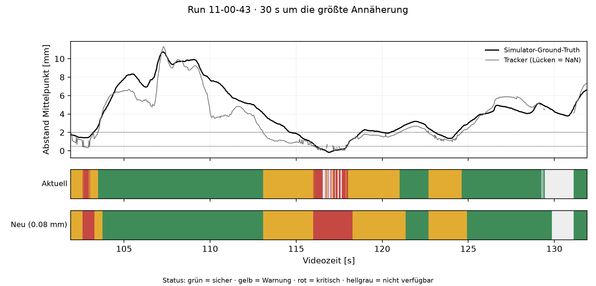
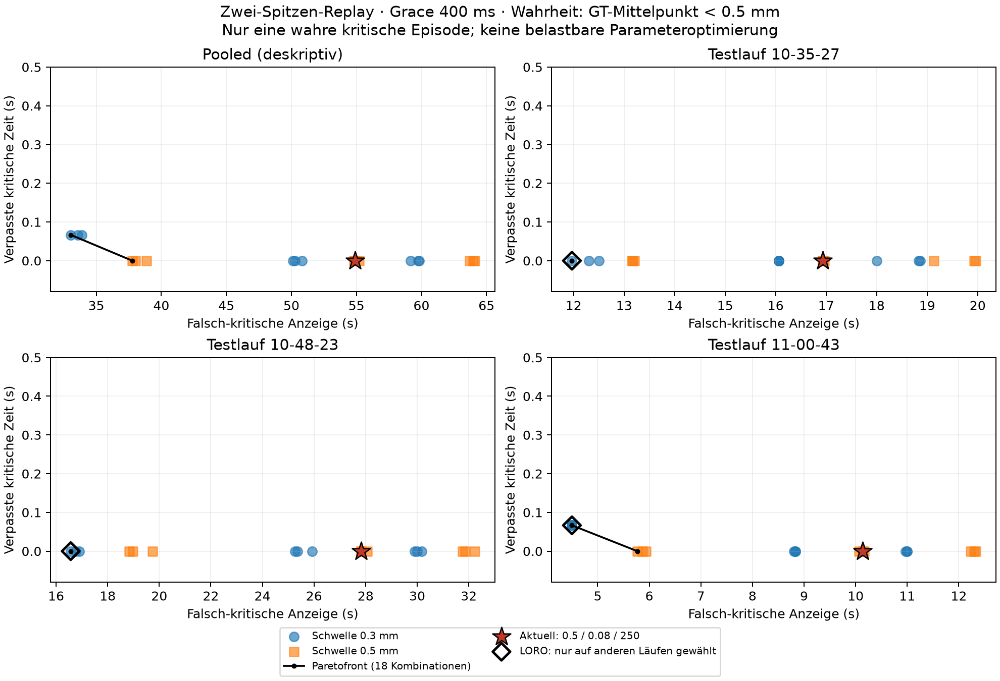
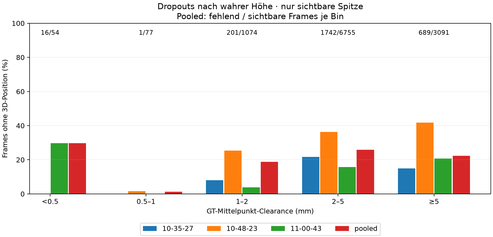

# Stabilität der Abstandswarnung – Simulator-Replay

**Empfehlung (vorläufig): Hysterese 0,08 mm, Deeskalations-Dwell 250 ms, Dropout-Grace 400 ms.**
Die Kombination senkt Statuswechsel um 64,5 % (106,5 → 37,8/min) und dropoutbedingte Alarmabbrüche von 126 auf 39.
Sie beseitigt die hier verpassten 0,63 s kritischer Zeit, erhöht aber falsch-kritische Anzeige von 13,83 auf 43,37 s.
Stabilität ist damit deutlich besser; geometrische Genauigkeit wird dadurch nicht besser.

## Methode und Codebezug

11 428 aufeinanderfolgende CSV-Frames, 380,93 s insgesamt (124,40 / 137,90 / 118,63 s), 30 Hz.
Ausgewertet wird jeweils der gesamte CSV-Ausschnitt, nicht die vollständige Aufnahme; keine Filterung nach `visible`.
26,48 % der Frames haben keine rekonstruierte Höhe. Zeitbasis `frame/30` (Logzeit hat konstanten Alignment-Offset).
Schwellen: kritisch <0,5 mm, Warnung <2 mm, sonst sicher; Ground Truth ohne Hysterese/Dwell.

Gelesener Ausgangsstand (andere Agenten können diese Dateien anschließend ändern):
- `services/viz/src/ui.js:30–33`, `services/viz/src/config.js:9–14`: Schwellen und bisher 0,05 mm Hysterese.
- `services/viz/src/feed/levels.js:14–18`: sofortige Eskalation, Deeskalation anhand `distanceLevel(max(0,h−margin))`; `:29–31`: NaN/fehlender Frame setzt Zustand zurück.
- `services/viz/src/feed/pipeline.js:80–102`: Ausfall setzt Level zurück und entfernt Messwerte; Level-/Verfügbarkeitswechsel werden sofort publiziert, sonst 100-ms-Readout (`config.js:22`).
- `services/viz/src/feed/trend.js:49–66`: Lückenmarker, Steigung/TTC; keine Glättung der Level-Eingabe.

`evaluate.py` emuliert diese **skalare** Level-Logik. Neu ist ein explizites vorgeschlagenes Modell, kein Nachweis der parallel entstehenden JS-Implementierung:
400 ms seit letzter gültiger Messung wird das Level gehalten, danach nicht verfügbar; keine Deeskalation ohne Messung.
Ein niedrigeres Ziellevel muss kontinuierlich 250 ms qualifizieren; Zielwechsel, erneute Eskalation oder NaN setzen den Dwell zurück.
Bei 30 Hz sind das mindestens 266,7 ms seit dem ersten qualifizierenden Frame. Eskalation bleibt sofortig.
Nach abgelaufener Grace beginnt die nächste gültige Messung ohne alten Zustand.
Numerische Werte gelten während NaN weiterhin als fehlend; nur die Statusfarbe wird gehalten.

Statuswechsel zählen **alle** Übergänge einschließlich nicht verfügbar, ohne künstliche Übergänge zwischen Läufen oder Initialisierung.
Kritisch-/Warn-Episoden sind zusammenhängende Abschnitte des jeweiligen Levels (kein binärer Alarmzähler).
Dropout-Ende = kritisch/Warnung → nicht verfügbar, bei Neu erst nach Grace; kritisch → Warnung zählt nicht als Alarmende.
Zeitanteile beziehen sich auf alle Frames. Verpasste kritische Zeit zählt auch Ausfälle als nicht kritisch;
falsch-kritisch zählt auch während Grace gehaltene falsche Alarme.
Onset-Latenz: erste kritische Anzeige innerhalb einer wahren kritischen Episode minus deren Beginn, Untergrenze 0;
ein bereits aktiver Fehlalarm ergibt daher 0 ms. Nicht detektierte Episoden werden separat gezählt.

## Jitter (mm)

Robust σ = 1,4826 × MAD. Δh nur zwischen direkt benachbarten gültigen Frames, keine Überbrückung von NaNs.
Rausch-σ aus Δh = robust σ(Δh)/√2 (nur Näherung: reale Bewegung, Korrelation und Ausreißer enthalten).
HP-Residuum = (h_rec−h_gt) minus zentrierter 15-Frame-Median (0,5 s), NaNs ignoriert, Randfenster verkürzt.
Pooled = zusammengeführte Stichproben, keine Differenzen über Laufgrenzen.

| Lauf | σ(Δh) | robust σ(Δh) | Rausch-σ | σ(HP) | robust σ(HP) |
|---|---:|---:|---:|---:|---:|
| 10-35-27 | 0.228 | 0.046 | 0.032 | 0.308 | 0.007 |
| 10-48-23 | 0.553 | 0.043 | 0.030 | 0.756 | 0.015 |
| 11-00-43 | 0.165 | 0.062 | 0.044 | 0.229 | 0.009 |
| pooled | 0.348 | 0.052 | 0.037 | 0.477 | 0.010 |

**Herleitung:** 2 × max(0,0367; 0,0104) = 0,0734 mm, auf 0,08 mm aufgerundet.
Der HP-Median kann langsame Fehler und an Lücken auch Jitter entfernen; deshalb die größere Δh-basierte Schätzung.
Die viel höheren Standardabweichungen zeigen seltene große Sprünge, die Hysterese allein nicht abfängt.
250 ms Dwell unterdrückt kurze Rückstufungen, ohne Eskalation zu verzögern; 400 ms Grace überbrückt bis zu zwölf fehlende Frames.
Beides ist ein praktikabler Startwert, kein optimierter/klinisch validierter Grenzwert. 0,15 mm reduziert zusätzlich nur
1,6 Wechsel/min (37,8 → 36,2), hält falsch-kritisch etwas länger (43,37 → 43,60 s); deshalb 0,08 mm bevorzugt.

## Replay: Stabilität und Zeitanteile

Neu jeweils Grace 400 ms + Dwell 250 ms. Anteile K/W/S/∅ = kritisch/Warnung/sicher/nicht verfügbar, in %.

| Lauf | Variante | Wechsel/min | Episoden K/W | Anteile K/W/S/∅ (%) | Alarmenden durch Dropout |
|---|---|---:|---:|---:|---:|
| 10-35-27 | Alt 0,05 | 92.6 | 31/40 | 4.6/24.9/47.6/22.9 | 36 |
| 10-35-27 | Neu 0,15 | 35.7 | 11/21 | 10.4/30.4/46.9/12.3 | 11 |
| 10-35-27 | Neu 0,08 | 35.7 | 11/21 | 10.4/30.1/47.2/12.3 | 11 |
| 10-48-23 | Alt 0,05 | 134.9 | 62/82 | 4.6/27.1/31.2/37.1 | 62 |
| 10-48-23 | Neu 0,15 | 40.5 | 26/25 | 17.2/31.2/27.8/23.9 | 20 |
| 10-48-23 | Neu 0,08 | 43.1 | 26/28 | 17.0/30.3/28.8/23.9 | 20 |
| 11-00-43 | Alt 0,05 | 88.0 | 30/33 | 2.5/13.7/66.0/17.8 | 28 |
| 11-00-43 | Neu 0,15 | 31.9 | 10/18 | 7.4/18.7/64.4/9.5 | 8 |
| 11-00-43 | Neu 0,08 | 33.9 | 10/20 | 7.4/18.1/65.0/9.5 | 8 |
| pooled | Alt 0,05 | 106.5 | 123/155 | 3.9/22.2/47.4/26.5 | 126 |
| pooled | Neu 0,15 | 36.2 | 47/64 | 11.9/27.0/45.4/15.6 | 39 |
| pooled | Neu 0,08 | 37.8 | 47/69 | 11.9/26.4/46.1/15.6 | 39 |

## Gegen Ground Truth

| Lauf | Variante | Kritisch verpasst (s) | Falsch kritisch (s) | Onset-Latenz Median (ms) | Onsets verpasst/gesamt |
|---|---|---:|---:|---:|---:|
| 10-35-27 | Alt 0,05 | 0.00 | 5.70 | — | 0/0 |
| 10-35-27 | Neu 0,15 | 0.00 | 12.90 | — | 0/0 |
| 10-35-27 | Neu 0,08 | 0.00 | 12.90 | — | 0/0 |
| 10-48-23 | Alt 0,05 | 0.00 | 6.30 | — | 0/0 |
| 10-48-23 | Neu 0,15 | 0.00 | 23.67 | — | 0/0 |
| 10-48-23 | Neu 0,08 | 0.00 | 23.47 | — | 0/0 |
| 11-00-43 | Alt 0,05 | 0.63 | 1.83 | 0 | 0/1 |
| 11-00-43 | Neu 0,15 | 0.00 | 7.03 | 0 | 0/1 |
| 11-00-43 | Neu 0,08 | 0.00 | 7.00 | 0 | 0/1 |
| pooled | Alt 0,05 | 0.63 | 13.83 | 0 | 0/1 |
| pooled | Neu 0,15 | 0.00 | 43.60 | 0 | 0/1 |
| pooled | Neu 0,08 | 0.00 | 43.37 | 0 | 0/1 |

Nur Run 11-00-43 enthält einen wahren kritischen Abschnitt (1,80 s): alt fehlen 35,2 %, neu 0 %.
**Ein einziger Onset erlaubt keine belastbare Aussage zur Erkennungslatenz.** In den beiden anderen Läufen sind sämtliche kritischen Anzeigen Fehlalarme.

## Abbildung, Grenzen und Reproduktion

PNG visuell geprüft: lesbare Achsen/Legende, weißer Hintergrund, Abstandskurven schwarz/grau,
Statusfarben ausschließlich in den Statusbändern. Die neue Logik schließt die kurzen Ausfälle am kritischen Abschnitt.

- Clearance ist der **Spitzenmittelpunkt**, nicht `min(L,R)` wie im Dashboard (`levels.js:33–41`); keine Aussage zur näheren Einzelspitze.
- CSV-Höhen beruhen auf Augenradius 12,05 mm; keine Neuberechnung mit dem UI-Radius von 12 mm (`config.js:4`).
- Orthographischer Tracker mit Modellfehler/Bias (siehe `writeup/learnings_trajectories.md`, §4.5); Stabilisierung korrigiert diesen Fehler nicht.
- Nur Simulator, drei Läufe einer Übung, keine unabhängige Validierung; Parameter auf denselben Daten hergeleitet und bewertet.
- Kein Browser-Test, keine Änderung an `services/viz`; vorgeschlagenes Grace-/Dwell-Verhalten ist bei Integration gegen die finale JS-Logik abzugleichen.

Reproduktion aus Repo-Wurzel: `.venv-ml/bin/python writeup/figures/viz/alarm_eval/evaluate.py`
(NumPy + Matplotlib; kein Pandas). Enthält sechs deterministische Checks für Schwellen, Reset, Grace, Dwell und sofortige Eskalation.
Artefakte neben diesem Bericht: `jitter.csv`, `metrics.csv` (ungerundete Werte), `replay.csv` (Frame-Level; −1=∅, 0=sicher, 1=Warnung, 2=kritisch), `alarm_timeline.png`.
Bereit zum Testen und zum Abgleich mit der neuen UI-Implementierung.

## Ergänzung 2026-11-05: UI-getreuer Zwei-Spitzen-Replay

**Dieser Abschnitt ergänzt die bisherige skalare Analyse; für die aktuelle UI sind die folgenden Werte maßgeblich.**
Pooled: Critical-PPV **3,17 %**, Sensitivität **100 %**, **54,90 s falsch-kritisch** bei nur **1,80 s wirklich kritischer Zeit**.
Die aktuelle Einstellung liegt im Zwei-Ziel-Raum Fehlalarmzeit/verpasste Zeit **nicht nahe der Paretofront**.
Das ist kein Nachweis für klinisch bessere alternative Parameter: Es gibt nur **eine** wahre kritische Episode.

### Methode und Prüfungen

- Dieselben 11 428 Frames / 380,93 s, 30 Hz; jeder Frame repräsentiert 1/30 s. Zeit relativ zum ersten CSV-Frame, kein Übergang zwischen Läufen.
- Rekonstruktion beider Einzelspitzen aus den gecachten 1080²-Detektionen mit `services/stream/tool_positions.py::compute_tool_positions` und `config/default_calibration.json`, einschließlich optionaler Lichtausrichtung. Wie in `scripts/eval_sim_gt.py::reconstruct`: Zentrum (540,540), **Pixelradius 540**, nicht der im Kalibrations-JSON gespeicherte Radius 500; normierte 3D-Spitzen anschließend ×12,05 mm.
- CSV-Evaluator-Maske beibehalten: `visible=1`, alle vier 2D-Punkte endlich, Rekonstruktion erfolgreich. Die Verfügbarkeitsmaske stimmt exakt mit `height_rec_mm` überein: **8 402 gültig / 3 026 fehlend**. Das Sichtbarkeits-Gating stammt aus dem Offline-Evaluator, nicht aus gemessener Live-Transporttelemetrie. Außerhalb dieser Maske werden keine Positionen erfunden.
- UI-Eingabe je Spitze: `max(0, 12 − |tip|)`; Anzeige = kritischeres Level von links/rechts. **Die UI stabilisiert beide Spitzen separat und kombiniert erst danach**, nicht nur einen skalaren Minimalabstand. Sofortige Eskalation; Hysterese 0,08 mm, Dwell 250 ms; jede Lücke unterbricht den Dwell. Grace gilt strikt **<400 ms** seit letzter gültiger Messung, danach Reset/∅. Fehlende Frames entsprechen `degraded`, nicht sofortigem `error`/`stale`.
- **Wahrheitsproxy:** geloggte `height_gt_mm` = radialer Abstand des **Spitzenmittelpunkts** zur physischen Kugel mit Radius ≈12,05 mm. Die reale Maulöffnung und Einzelspitzen-GT fehlen. Deshalb sind „falsch“ und „verpasst“ immer **gegen diesen Proxy**, nicht nachgewiesene Einzelspitzenfehler.
- PPV = gemeinsame Zeit von Anzeige und wahrer Unterschreitung / gesamte Anzeigezeit; Sensitivität = dieselbe gemeinsame Zeit / gesamte wahre Unterschreitungszeit. Critical: Anzeige=2 und GT<0,5 mm; ≥Near retina: Anzeige≥1 und GT<2 mm. Grace-Haltungen zählen als Anzeige; ∅ zählt als nicht erkannt. Ohne wahre positive Zeit ist Sensitivität **nicht definiert**, nicht 0 %.
- **Kein Browser-Test.** Python-Replay gegen die tatsächliche importierte JS-Pipeline (`publish` + `tick`) frameweise geprüft: **11 428/11 428 Statuswerte identisch**; zusätzlich sieben deterministische Grenz-/Dwell-/Grace-Checks. Keine UI-Datei geändert. SHA-256 der gelesenen Quellen und Eingaben in `ui_provenance.json`; Quellhashes vor/nach dem Lauf identisch.
- Der Detektionscache ist auf 0,01 px und die alte 3D-CSV auf 0,001 mm gerundet. Maximaler 3D-Mittelpunkt-Roundtripfehler: 0,00242 / 0,00588 / 0,00167 mm; keine exakte Submillimeter-Nachkommastellenreproduktion der alten Rohrechnung zu erwarten.

### Minimalabstand gegenüber rekonstruiertem Mittelpunkt

Differenz = UI-Mittelpunkt-Clearance minus UI-`min(L,R)` (beide mit Radius 12 mm und Clamp); positiv bedeutet: Einzelspitze näher an der Retina.
Nur gültige Rekonstruktionsframes; pooled aus allen Frames, nicht Mittel der Laufquantile.

| Lauf | Gültige Frames | Differenz Median (mm) | p95 (mm) |
|---|---:|---:|---:|
| 10-35-27 | 2 877 | 0,081 | 0,598 |
| 10-48-23 | 2 601 | 0,107 | 0,623 |
| 11-00-43 | 2 924 | 0,117 | 0,602 |
| pooled | 8 402 | **0,101** | **0,614** |

### Güte und Statuswechsel, aktuelle UI-Parameter

| Lauf | Critical-PPV | Critical-Sens. | ≥Near-PPV | ≥Near-Sens. | Wechsel/min | Falsch Critical (s) | Verpasst Critical (s) |
|---|---:|---:|---:|---:|---:|---:|---:|
| 10-35-27 | 0,00 % | — | 10,67 % | 70,68 % | 39,07 | 16,93 | 0,00 |
| 10-48-23 | 0,00 % | — | 30,05 % | 78,53 % | 41,77 | 27,83 | 0,00 |
| 11-00-43 | 15,08 % | 100,00 % | 26,24 % | 96,49 % | 31,86 | 10,13 | 0,00 |
| pooled | **3,17 %** | **100,00 %** | **22,60 %** | **80,87 %** | **37,80** | **54,90** | **0,00** |

Pooled Nenner: Critical angezeigt **56,70 s**, wahr **1,80 s**, Überlappung **1,80 s**;
≥Near angezeigt **160,90 s**, wahr **44,97 s**, Überlappung **36,37 s**, verpasst **8,60 s**.
240 Statuswechsel zählen alle Übergänge einschließlich ∅, aber keine Initialisierung.
Die Radiusdifferenz erklärt das schlechte PPV nicht: Mit alternativem GT-Proxy `height_gt_mm−0,05` (gleiche 12-mm-Kugel wie UI)
ergeben sich Critical-PPV **3,23 %**, Sensitivität **100 %**, ≥Near-PPV **24,38 %**, Sensitivität **81,00 %**;
Detailwerte in `ui_truth_radius_sensitivity.csv`. Diese Alternative ist nur eine Sensitivitätsanalyse, keine andere physische Wahrheit.

### Effektive wahre Höhe bei Critical-Onsets

Jeder Beginn einer zusammenhängenden Critical-Anzeige, auch nach Lücken/Wiedererkennung; keine Gewichtung nach Episodendauer.
Das sind **Anzeige-Onsets**, nicht 59 unabhängige echte Gefahrensituationen.

| Lauf | Onsets | Minimum (mm) | p05 (mm) | Median (mm) | p95 (mm) | Maximum (mm) |
|---|---:|---:|---:|---:|---:|---:|
| 10-35-27 | 16 | 2,334 | 2,471 | 3,439 | 5,317 | 5,355 |
| 10-48-23 | 29 | 0,730 | 1,066 | 2,729 | 6,621 | 8,163 |
| 11-00-43 | 14 | 0,975 | 1,272 | 3,157 | 6,629 | 7,193 |
| pooled | **59** | **0,730** | **1,086** | **3,017** | **6,407** | **8,163** |

Kein Anzeige-Onset liegt bereits unter 0,5 mm GT. Die einzige wahre kritische Episode (Run 11-00-43, Frames 3485–3538)
beginnt bei Replayzeit 100,033 s; Critical ist seit Frame 3475 / 99,700 s aktiv, bei GT **0,975 mm**:
**333 ms Vorlauf** gegen den Mittelpunkt-Proxy. 100 % Sensitivität ist hier auch Folge eines bereits gehaltenen Alarms,
kein Beleg einer präzisen 0,5-mm-Erkennung. Vollständige Onsets: `ui_critical_onsets.csv`.

### Parametersweep und Leave-one-run-out

**18 Kombinationen:** Critical-Schwelle {0,3; 0,5} mm × Hysterese {0,05; 0,08; 0,15} mm × Dwell {0; 250; 500} ms;
Warnschwelle 2 mm und Grace 400 ms bleiben fest. **Wahrheitslabel bleibt immer GT<0,5 mm**, auch beim 0,3-mm-Anzeigeschwellwert.
Pro Fold Auswahl nur auf den beiden Trainingsläufen durch Minimierung von **falsch-kritischen + verpassten Sekunden** (gleiche Kosten pro Sekunde).
Bei Gleichstand weniger Statuswechsel, danach aktuelle Kombination bevorzugt, dann feste Gitterreihenfolge.
Diese willkürliche, explizite Kostenfunktion ist **keine klinische Nutzenfunktion**.
Alle drei Folds wählen **0,3 mm / 0,05 mm / 0 ms**.

| Zurückgehaltener Testlauf | Wahre kritische Episoden im Training | Falsch Critical: gewählt / aktuell (s) | Verpasst: gewählt / aktuell (s) | Wechsel/min: gewählt / aktuell |
|---|---:|---:|---:|---:|
| 10-35-27 | 1 | 11,97 / 16,93 | 0,00 / 0,00 | 58,36 / 39,07 |
| 10-48-23 | 1 | 16,57 / 27,83 | 0,00 / 0,00 | 72,23 / 41,77 |
| 11-00-43 | **0** | 4,50 / 10,13 | **0,067 / 0,00** | 40,46 / 31,86 |
| Out-of-fold pooled | — | **33,03 / 54,90** | **0,067 / 0,00** | **57,81 / 37,80** |

Gewählte Out-of-fold-Sensitivität **96,30 %** statt 100 %; die zwei verpassten Frames liegen in der einzigen kritischen Episode.
**Genau der Fold mit kritischem Testereignis hat kein kritisches Trainingsereignis.** LORO verhindert direkten Testlauf-Leakage,
liefert aber mit drei abhängigen Simulatorläufen keine belastbare Generalisierungs- oder Sicherheitsabschätzung.

Die dargestellten lokalen Fronten verwenden alle 18 Testlauf-Ergebnisse nur **deskriptiv**; die schwarzen Rauten markieren die ausschließlich auf anderen Läufen gewählte Kombination.
Pooled hat die Zwei-Ziel-Paretofront zwei eindeutige Punkte:
**33,03 s falsch / 0,067 s verpasst** (0,3 / 0,05 / 0) und **37,77 s falsch / 0 s verpasst** (0,5 / 0,05 / 0).
Aktuell: **54,90 s / 0 s** — **17,13 s bzw. 45,4 % mehr** falsch-kritisch als der Null-Miss-Frontpunkt.
Damit **nicht auf/nahe der Front dieser beiden Ziele**; allerdings weniger Flackern: **37,80 statt 56,39 Wechsel/min**.
Die Parameterentscheidung hängt also wesentlich vom dritten Ziel Stabilität und den Kosten verpasster Gefahr ab.
Keine automatische Umstellung empfohlen; zuerst mehr unabhängige echte Grenzannäherungen und Einzelspitzen-GT erfassen.

### Dropouts nach wahrer Höhe

Nur Frames mit `visible=1`; Einträge **fehlend / sichtbare Frames (Prozent)**.
Intervalle links geschlossen/rechts offen, außer <0,5; letzte Klasse ≥5 mm. „—“ = keine beobachteten Frames, **nicht 0 %**.

| Lauf | <0,5 mm | 0,5–1 mm | 1–2 mm | 2–5 mm | ≥5 mm |
|---|---:|---:|---:|---:|---:|
| 10-35-27 | — | — | 12/150 (8,0 %) | 487/2244 (21,7 %) | 172/1154 (14,9 %) |
| 10-48-23 | — | 1/63 (1,6 %) | 181/715 (25,3 %) | 961/2643 (36,4 %) | 231/554 (41,7 %) |
| 11-00-43 | 16/54 (29,6 %) | 0/14 (0,0 %) | 8/209 (3,8 %) | 294/1868 (15,7 %) | 286/1383 (20,7 %) |
| pooled | **16/54 (29,6 %)** | **1/77 (1,3 %)** | **201/1074 (18,7 %)** | **1742/6755 (25,8 %)** | **689/3091 (22,3 %)** |

**Keine monotone Häufung zur Retina nachweisbar.** Direkt unter 0,5 mm fallen 29,6 % der Frames aus, jedoch ausschließlich innerhalb **einer** Episode;
0,5–1 mm hat dagegen nur 1,3 % Ausfälle. Deskriptiv sind nahe <2 mm **218/1205 = 18,1 %** betroffen,
ab 2 mm **2431/9846 = 24,7 %**. Frames sind zeitlich korreliert, die kleinen nahen Bins und Laufunterschiede erlauben keine kausale Aussage.
Insgesamt 11 051 sichtbare Frames, davon 2 649 ohne 3D (24,0 %); die weiteren 377 unsichtbaren Frames gehen nicht in diese Tabelle ein.

### Wie enden Critical-Episoden?

„Abstand gestiegen“ bezeichnet **rekonstruierte** Clearance mit qualifizierter Deeskalation, nicht zwingend einen Anstieg der Wahrheit.
„Datenverlust“ = Critical→∅ nach abgelaufener 400-ms-Grace, nicht schon der erste fehlende Frame.

| Lauf | Critical-Episoden | Ende durch Grace-Ablauf | Ende durch Clearance-Anstieg | Am CSV-Ende noch aktiv |
|---|---:|---:|---:|---:|
| 10-35-27 | 16 | 8 | 8 | 0 |
| 10-48-23 | 29 | 17 | 11 | 1 |
| 11-00-43 | 14 | 7 | 7 | 0 |
| pooled | **59** | **32** | **26** | **1** |

**32/58 = 55,2 % der beobachteten Critical-Enden** entstehen durch Datenverlust; bezogen auf alle Episoden **32/59 = 54,2 %**.
Die rechtszensierte letzte Episode darf nicht als geometrisches Ende gezählt werden. Episodentrace: `ui_critical_episodes.csv`.

### Reproduktion und Grenzen

`.venv-ml/bin/python writeup/figures/viz/alarm_eval/evaluate_ui.py` (NumPy, Matplotlib, Node.js).
Erzeugt nur die neuen `ui_*.csv`, `ui_provenance.json` und beide PNGs in diesem Verzeichnis; bestehender skalarer Replay und Bericht bleiben erhalten.
Optional `.venv-ml/bin/python writeup/figures/viz/alarm_eval/evaluate_ui.py > writeup/figures/viz/alarm_eval/ui_summary.json`.
**Achtung:** Das ältere `evaluate.py` schreibt `results.md` vollständig neu; nach dieser Ergänzung nicht ungeprüft ausführen.
Tabellen mit ungerundeten Daten: `ui_metrics.csv`, `ui_tip_difference.csv`, `ui_onset_summary.csv`, `ui_dropouts.csv`, `ui_sweep.csv`, `ui_loro.csv`;
Frame-Level: `ui_replay.csv` (−1=∅, 0=sicher, 1=Near retina, 2=Critical).

Beide neuen PNGs selbst visuell geprüft: vollständige Achsen, lesbare Legenden, keine abgeschnittenen Beschriftungen.
Im Dropoutdiagramm sind Klassen ohne Frames ohne Balken; die Tabelle unterscheidet sie explizit von 0 %.
Simulator-/Projektionsbias, nur ein positiver Abschnitt, gerundete Eingaben, unbekannte echte Maulöffnung,
Offline-Verfügbarkeitsmaske und unbekanntes Live-Timing begrenzen die Aussagekraft.
**Fazit:** Hysterese/Dwell stabilisieren die Anzeige, kalibrieren aber keine reale Gefahrennähe. Die aktuelle UI erreicht hier hohe Sensitivität durch viel zu frühe/zu lange Critical-Anzeigen.
Auswertung fertig; bereit zum Testen durch den Nutzer. Kein Commit, keine Browserprüfung, keine Änderungen an `services/viz` oder `writeup/viz_design.md`.

## Ergänzung 2026-11-05: angezeigtes Level und stabilisierte Spitzenwahl

Reproduktion: `node writeup/figures/viz/alarm_eval/display_analysis.mjs` (ohne Zusatzpakete).
`display_accuracy.csv`: Gruppierung nach **angezeigtem** Level aus `ui_replay.csv`, nur endliche aktuelle Messungen (8.402 Frames). Wahrheit: geloggte Tip-Mittelpunkt-Clearance. Fehler: ungerundetes min(L,R) minus Wahrheit. Damit werden die Review-Zahlen bestätigt; keine Aussage über klinische Genauigkeit.

| Anzeige | n | Wahrheit Median mm | P10–P90 mm | wahr <0,5 mm | wahr <2 mm | Median Fehler mm |
|---|---:|---:|---:|---:|---:|---:|
| Clear | 4.412 | 4,93 | 3,06–8,50 | 0 % | 0,11 % | −0,59 |
| Near | 2.972 | 2,48 | 1,59–3,35 | 0 % | 25,67 % | −0,70 |
| Critical | 1.018 | 2,94 | 0,97–5,56 | 3,73 % | 21,51 % | −2,23 |

Zusätzlich `display_accuracy_with_grace.csv`: alle tatsächlich publizierten Messwerte einschließlich Grace und Readout-Throttling (9.584 Frames). Clear/Near/Critical: n=4.757/3.126/1.701; Wahrheit Median=4,94/2,48/3,08 mm, P10–P90=3,07–8,55 / 1,62–3,41 / 1,18–5,58 mm; Anteil wahr <0,5 mm=0/0/3,17 %, <2 mm=0,11/25,21/17,81 %; Medianfehler=−0,59/−0,74/−2,60 mm. Die Live-Genauigkeitstexte verwenden die erste Tabelle; bei Grace hat weiterhin der Signal-gap-Text Vorrang.

Spitzenwahl: echte JS-Pipeline mit rekonstruierten radialen Tips aus den beiden gespeicherten Clearances (die Logik hängt nur von diesen Abständen ab), identischen Zeiten, Grace und 100-ms-Readout. Alle **11.428** resultierenden Levels je Variante stimmen per Assertion mit `ui_replay.csv` überein. Ausgangsvariante: ursprüngliches `nextNearestTip`, Dwell=0; Kandidaten unverändert mit 0,10/0,15-mm-Tieband. Ausfälle unterbrechen Dwell; abgelaufene Grace setzt die Wahl zurück. Wechsel zählen publizierte Labels zwischen zwei verfügbaren Messungen, ohne Initialisierung, Verfügbarkeitskanten oder Laufgrenzen; Nenner gesamte 380,93 s. Direkte Flips schließen Übergänge über Tie aus.

| Dwell ms | Labelwechsel | /min | direkte L↔R | /min | Wechsel bei min <2 mm |
|---|---:|---:|---:|---:|---:|
| 0 | 449 | 70,72 | 101 | 15,91 | 55,46 % |
| 300 | 83 | 13,07 | 16 | 2,52 | 33,73 % |
| 400 | 68 | 10,71 | 15 | 2,36 | 38,24 % |
| **500 (implementiert)** | **63** | **9,92** | **13** | **2,05** | **36,51 %** |

42,89 % der verfügbaren Anzeigezeit liegt min(L,R) unter 2 mm. |L−R| über endliche Messungen: P10=0,024, Median=0,178, P90=0,767, P95=1,197 mm; robuste Rauschschätzung aus benachbarten Differenzen (1,4826×MAD/√2)=0,0206 mm. Das bestehende Tieband ist bereits größer als diese Rauschschätzung; daher unverändert, zusätzliche zeitliche Stabilisierung. **500 ms** hat unter den geprüften Varianten die wenigsten Wechsel (−85,97 %). Alle 37 Abschnitte mit ≥1 s konsistenter Seite und |L−R|>0,15 mm werden erreicht; maximale publizierte Latenz 567 ms (300/400 ms: 367/467 ms). Kurze reale Seitenwechsel werden bewusst zurückgehalten; keine unabhängige klinische Validierung. Vollständige Zahlen und Quellhashes: `display_analysis.json`, `nearest_stability.csv`.

Implementierung: `services/viz/src/feed/pipeline.js` (Dwell), `config.js` (Konstanten und gemeinsame 0,12-mm-Maulschwelle), `ui.js`/`components/HUD.jsx` (Leveltexte und bisherige Priorität), `geometry.js:readoutTip` und beide Retikel/Distanzansichten (publizierte Seite, Tie=Mittelpunkt, Zahl unverändert Minimum). Keine UI-Elemente hinzugefügt/entfernt.

Layoutprüfung im Browser bei 318 px Panel / 282 px Inhaltsbreite: alle drei neuen Texte **einzeilig**; Qualifier 12 px, reservierte Höhe 34,80 px; Nearest tip 13 px in Body-Textfarbe, Höhe 18,84 px. Bei Live-Text, Signal gap, unkalibriert, niedriger Konfidenz und fehlender Messung bleiben Panelhöhe 328,14 px und Balkenposition identisch. Tests: 54/54; `npx vite build` erfolgreich (Chunkgrößenwarnung). Capture-Skript und Screenshot-Ausgaben unberührt; kein Commit.
