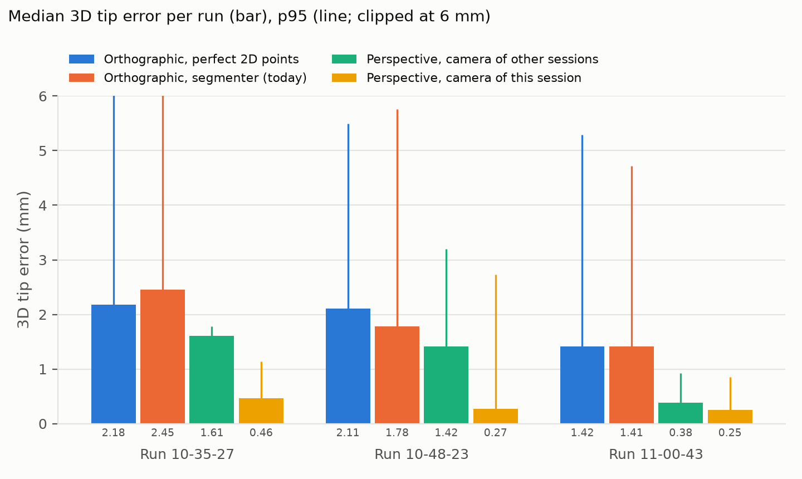
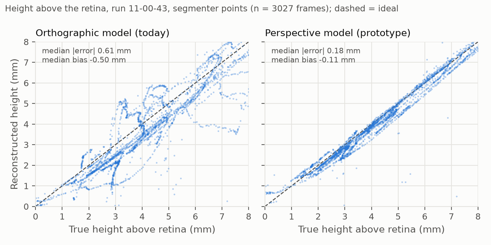

# Verifying the 3D forceps tracking with the simulator's trajectory logs

*Working notes for the final write-up – collected learnings, numbers and figures. Status: 2026-11-03.*

## 1 Why trajectory logs were necessary

The tracking pipeline finds the two forceps tips and the two tips of their shadow in the microscope image (2D) and
reconstructs the 3D tip position from them (`services/stream/tool_positions.py`): the tip must lie on the ray from the
light source through its shadow on the retina, and its image position fixes where on that ray. Until these logs were
available, only the **2D detection** could be checked: 43 hand-labelled frames, pixel error of the tips (`make eval`).
That left the 3D stage unverifiable, for four reasons.

1. **Depth is not observable in a single image.** The reconstruction re-projects onto exactly the 2D points it was
   given, whatever its depth error. A wrong camera model or a wrong trocar position therefore produces a self-consistent,
   plausible-looking but wrong 3D position, and nothing in the video reveals it. Hand labels cannot help either: nobody
   can label depth in a monocular image.
2. **The model's parameters were guesses.** Trocar positions, eye radius (24 mm), jaw length (3 mm), light position
   and the camera model all had to be assumed. None of them can be measured from the video alone.
3. **Errors could not be attributed.** With only an end result, a 3D error could stem from the detection, from the
   calibration, or from the geometric model. Separating them needs a metric ground truth that can replace each input
   in turn (ablation, §3).
4. **Scale.** Hand labels give 43 frames, 2D only. The logs give a metric 6-DoF pose for every frame: ~10 000 frames
   in three runs, including the height above the retina, which is the quantity that matters clinically.

The Haag-Streit Eyesi simulator writes, alongside each recorded video, a trajectory log (`<video>_trajectories.csv`)
with the poses of the eye, the forceps and the light probe. This turns every simulator recording into a fully labelled
3D test set at no labelling cost.

## 2 Data

| run (2026-10-22, user `mapskap1`, *forceps training lev 1*) | duration | eye poses | forceps poses | lamp poses |
|---|---|---|---|---|
| 10-35-27 | 138 s | 4132 | 3750 | 14 (over 2.6 s) |
| 10-48-23 | 155 s | 4643 | 4156 | 178 (over 145 s) |
| 11-00-43 | 138 s | 4151 | 3579 | 15 (over 0.5 s) |

Each run also has an MP4 video: 1080 × 1080 px at 30 fps.

**Log format:**
- Each row is `t_ms;TOPIC;m0..m15`, a 4 × 4 homogeneous pose, column-major, in mm, with the origin at the eye centre.
- Topics: `VRTOPIC_EYE`, `VRTOPIC_ENDGRIPPINGFORCEPS`, `VRTOPIC_LAMP`, plus `VROBJECT_INSERT`/`REMOVE` events.
- Instrument poses are given in the eye's frame.
- The forceps origin is the midpoint of the two jaw tips; its local z axis is the shaft.
- Eye and forceps are logged at ~30 Hz. The lamp is logged only briefly after insertion, except in 10-48-23.

**Not in the log:** the jaw opening (so we evaluate the **tip midpoint**), the microscope zoom/position, and the camera.

## 3 Method

All of this is implemented in `scripts/eval_sim_gt.py` and run with `make sim-eval`.

1. **Time alignment.** The video lags the log by **+167 ms**, found the same in all three runs. Frames are matched to
   poses interpolated at `frame / 30 s + 167 ms`.
2. **Camera.** A pinhole camera is fitted by DLT. It maps the logged forceps tip, transformed by the logged eye pose,
   onto the detected tip midpoint in the video (11 parameters, ~3500 frames, outliers trimmed).
3. **Trocars.** Each trocar is the least-squares point closest to all logged instrument axes (remote centre of motion).
4. **Ground truth** for every frame: the tip midpoint in the pipeline's frame (camera axes, origin at the eye centre,
   in mm) and its height above the retina, `r_eye − |p|`.
5. **Ablation.** The same reconstruction is fed three kinds of input:
   - (a) the true tip plus a modelled shadow (light at the lamp trocar, retina = eye sphere). This gives the error of
     the 3D model alone.
   - (b) the true tip plus the detected shadow.
   - (c) the full pipeline: eye circle → detector → calibration → `tool_positions.py`.
6. **Perspective prototype** (issue #1). The same inputs go through a perspective reconstruction instead (§4.5;
   `writeup/figures/make_figures.py`).

## 4 Learnings

### 4.1 The log and the video agree to sub-pixel precision

The fitted camera reproduces the detected forceps tips to **0.40–0.50 px median** in all three runs. Its other
parameters agree closely between runs too:

- focal length 1440–1473 px (2.99–3.03 eye-circle radii);
- centre 21.8–22.0 mm from the eye centre, almost on the axis.

So the simulator renders a plain pinhole camera without distortion, and the log is a trustworthy ground truth for this
footage.

### 4.2 The real calibration differs strongly from the guessed one

| | guessed before | measured from the logs |
|---|---|---|
| eye radius | 24 mm | **12.05 mm** (all trocars lie on this sphere) |
| jaw length | 3.0 mm | **1.9 mm** |
| forceps trocar (`rot_up` / `rot_clock`) | 0.737 / 0.575 rad | **0.633 / −2.732 rad** |
| light trocar | 0.681 / 2.708 rad | **0.681 / −0.530 rad** |
| light depth | – | **0 mm** (the light sits at its trocar) |

- **The old angles were for a 180°-rotated image.** They fitted the earlier sample video, which is turned by 180°
  against the simulator's own orientation (Haag-Streit logo upright, instruments from the upper left). This also
  explains why the live capture needed `ROT=180` with the old values; with the measured ones it runs with `ROT=0`.
- **The trocars are identical in all three runs.** In the eye frame they agree to ≤ 0.01 mm: forceps
  (6.56, −3.83, 9.35) mm, lamp (−6.55, −3.69, 9.41) mm. Every logged shaft axis passes exactly through the forceps
  trocar.
- **The light stays at its trocar.** The logged lamp tip moves by ≤ 0.8 mm, which confirms that the light was inserted
  minimally and fixed.

### 4.3 The eye moves – and the calibration is relative to the camera

The simulator rotates the eye while the user works:

- up to **4°** within a run;
- **4–10°** between the runs' average poses.

The trocars are fixed in the eye, but the pipeline expresses them relative to the camera. The calibration angles seen
by the camera therefore change by up to ±0.1 rad between sessions. The committed calibration is the average pose over all
three runs, so a single fixed calibration is off by a few degrees in every session (see §4.6).

### 4.4 Detection is no longer the bottleneck

On run 11-00-43, 3528 frames with the tip in view (median / p95, in mm):

| input to the 3D stage | 3D error | height error | frames with a 3D position |
|---|---|---|---|
| (a) true tip + modelled shadow | 1.42 / 5.3 | 0.63 / 2.9 | 100 % |
| (c) learned segmenter (mlseg) | **1.40 / 4.2** | **0.60 / 2.0** | **83 %** |
| (c) classical detector (no background image) | 1.82 / 7.5 | 1.11 / 5.5 | 49 % |

- **The learned segmenter is accurate.** It finds the forceps tips in 97–99 % of the frames (0.4–0.6 px median) and
  the shadow in 86–88 % (69 % in 10-48-23, not investigated yet).
- **Its 3D error equals the model's own limit (a).** Feeding perfect 2D points does not improve the result, so any
  further gain has to come from the 3D model.
- **The classical detector is limited by the shadow.** It finds the shadow in only 56 % of the frames, and its shadow
  errors add ~0.4 mm.

### 4.5 The orthographic camera model is the dominant error

`tool_positions.py` assumes an orthographic camera (image x/y = eye x/y / eye-circle radius). The real camera is only
22 mm from the eye centre. Replacing the model by a perspective one (prototype; same 2D points, same trocar
calibration) gives:



*Fig. 1 – Median 3D tip error per run; the thin line is the p95.*

- **Blue vs orange:** perfect 2D points do not beat the segmenter, so the error is in the model.
- **Yellow (camera fitted per session):** 0.25–0.46 mm, i.e. an error reduced by 70–90 %.
- **Green (fixed camera averaged from the other sessions):** 0.38–1.61 mm. Better than today, but a near-constant
  offset remains (e.g. 10-35-27: 1.61 / p95 1.78).

| median / p95 3D error (mm) | 10-35-27 | 10-48-23 | 11-00-43 |
|---|---|---|---|
| orthographic, perfect 2D points | 2.18 / 11.7 | 2.11 / 5.5 | 1.42 / 5.3 |
| orthographic, segmenter (today) | 2.45 / 10.2 | 1.78 / 5.8 | 1.41 / 4.7 |
| perspective, camera of the other sessions | 1.61 / 1.8 | 1.42 / 3.2 | 0.38 / 0.9 |
| perspective, camera of this session | 0.46 / 1.1 | 0.27 / 2.7 | 0.25 / 0.9 |



*Fig. 2 – Reconstructed vs. true height above the retina (run 11-00-43, segmenter points).*

- **The orthographic model underestimates the height systematically (−0.50 mm).** This is safety-relevant: the
  forceps is reported closer to the retina than it is.
- **The perspective model removes the bias** (−0.11 mm) and cuts the median error from 0.61 to 0.18 mm.

### 4.6 Consequence: the camera must be calibrated per session

- **Same zoom across the runs.** The focal length relative to the eye circle was 2.99–3.03 in all three runs, so they
  were recorded at the same zoom.
- **But the session geometry still varies:**
  - camera offset up to 0.6 mm;
  - eye tilt towards the camera;
  - position of the auto-detected eye circle.
- **Why that matters:** a camera measured once and hard-coded leaves ~0.4–1.6 mm, while a camera calibrated per
  session reaches 0.25–0.46 mm.
- **Proposals (issue #1):**
  - (A) always use the same zoom – feasibility on the Eyesi still unclear;
  - (B) a short calibration phase per session that fits camera and trocar angles, e.g. from ~30 s of forceps movement
    and the simulator's log.

## 5 Limitations

- **Simulator only.** The rendering, the eye model (a perfect sphere) and the shadow are idealised; real optics
  (refraction at the cornea/lens, distortion) are not covered.
- **The camera fit uses our own detections** of the forceps tips. With 11 parameters on ~3500 frames and a 0.4 px
  residual the dependence is weak, but the 2D tip error is measured against a camera partly fitted to it.
- **"Camera of this session" is fitted on the evaluated run itself** (in-sample). It is an optimistic bound for a
  per-session calibration; the leave-one-out row is the realistic fixed-camera case.
- **The shadow ground truth is modelled.** The lamp is mostly logged only briefly, and the light is treated as a
  point at the trocar. The shadow error in (a)/(b) is therefore approximate (~9 px median against the model).
- **No jaw opening in the log.** Only the tip midpoint is evaluated, not the two tips separately.
- **Small sample.** Three runs, one user, one day, one exercise (*forceps training lev 1*), one zoom.

## 6 Reproduce

```bash
make weights                                   # model weights (rsync from the shared host)
make sim-eval SIM=TestRuns/<run>/<run>.mp4     # per run -> artifacts/sim_gt_*; DET=classic for the classical detector
# figures: the detections of each run have to be in artifacts/sim_gt_<HH-MM-SS>_ml_detections.csv
.venv-ml/bin/python scripts/eval_sim_gt.py TestRuns/<run>/<run>.mp4 --out artifacts/sim_gt_<HH-MM-SS>
.venv-ml/bin/pip install matplotlib && .venv-ml/bin/python writeup/figures/make_figures.py
```

The recordings (`TestRuns/`) are not in git (≈ 60 MB each).
