# Design rationale of the depth-guidance workstation

*Working document for the final write-up – why each element of `services/viz` looks and behaves the way it does, and what changed in
the review iteration. Status: 2026-11-05. Source references use checked current files/functions rather than fragile line numbers. Paths are relative to `services/viz/` unless a path starts with `services/` or `writeup/`; `src/classic` is not covered.*

**How to read it.** Every claim is tagged by its basis: a **measurement** (simulator logs, replay, colour model; source given), a **reference** (numbered list
in §8), or **reasoning** (a design argument without a direct empirical source). None of the thresholds or time constants is clinically validated.

## 1 Purpose, users and the three questions

`services/viz` ("Microforceps / Depth guidance") is a proof-of-concept workstation for vitreoretinal microsurgery **training on the Haag-Streit Eyesi
simulator**. It is not a medical device and makes no claim of clinical suitability. The tracker reconstructs the 3D positions of the two forceps jaw tips from
the microscope image (`services/stream/tool_positions.py`); the UI turns them into a clearance above the retina.

**Users.** The trainee at the simulator, who glances at the workstation between looks into the simulator's oculars, an instructor watching the same screen live,
and both of them during debriefing. Every reader therefore reads it in glances. This drives the "glanceable first, detail second" layout. The alarm is visual only by the owner's decision (§3.4, §6).

**Three questions** the screen must answer at a glance (reasoning; they map onto perception / comprehension / projection in Endsley's situation-awareness model
[S1]):

| | question | primary answer | secondary answer |
|---|---|---|---|
| Q1 | How close is the instrument to the retina? | clearance number + status word (①) | scene alarm (⑦), drop line / label (⑧), scope (⑥) |
| Q2 | Which tip is closer? | "Nearest tip: L / R / L ≈ R" + per-tip bars (③) | drop line + reticle anchored at the nearest tip, in the scope (⑥) and the main view (⑧) |
| Q3 | Is it getting closer? | approach trend + motion word (④) | – (no prediction, §6) |

Everything else is context (instrument state ⑤, eye model ⑩), view control (⑪–⑬) or trust (data source, connection, accuracy note ②, ⑭); ⑮ is the legend.

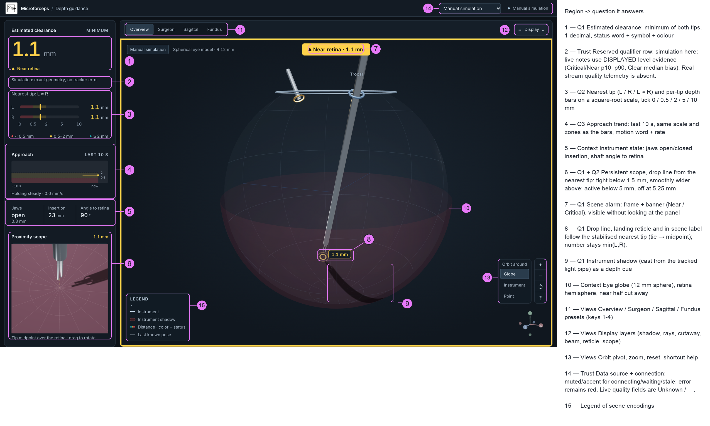

*Fig. 1 – Current UI in the warning state (manual simulation, pose clearance 1.196 mm shown as "1.1", Overview preset),
each region labelled with the question it answers. Screens: `figures/viz/after/`, 1600 × 1000 CSS px.*

**Layout rule (reasoning).** The left column is a fixed reading order from coarse to fine: one number, which tip, the history, instrument context, the magnified
close-up. The clearance card reserves the qualifier (two lines) and "Nearest tip" row even without data (`src/components/HUD.jsx`,
`src/workstation.css`); placeholders keep the bars and Approach panel fixed (`after/03`, `17`, `19`, `20`). The scope keeps its standby area (Fig. 1 ⑥ vs.
`after/01_far_overview.png`), and the instrument card keeps its jaw-opening note row as "—" without data
(`src/components/InstrumentStatus.jsx`), so every panel of the column starts at the same position with and without a
measurement (compare the recaptured warning, live Critical, held and ghost states in `after/03`, `17`, `19`, `20`). This helps the
eye return to the same place [S5, unverified edition]. The 3D view carries only spatial cues and the scene-wide alarm, never the only copy of a number.

## 2 Measurement contract and accuracy budget

### 2.1 What the number means

- **Clearance per tip:** `d = max(0, 12 mm − ‖tip‖)`, the radial distance to an ideal 12 mm sphere centred at the eye
  centre (`src/geometry.js`, `src/config.js`). Tips outside the sphere read 0, not negative.
- **Displayed clearance:** `min(d_L, d_R)`, the nearer jaw tip (`src/components/HUD.jsx`). Heading "Estimated
  clearance", eyebrow "Minimum".
- **Not included:** retinal shape beyond a sphere, refraction, the per-session eye radius (12.05 mm measured from the
  logs, learnings §4.2), the jaw opening as measured truth (the log only has the tip midpoint).

### 2.2 Measured error

From the simulator trajectory logs (learnings §4.4–4.5; pooled numbers: `figures/viz/design/approach_speed.py` on `alarm_eval/replay.csv`, tip midpoint, segmenter input, orthographic 3D model):

| height error (reconstructed − true) | all frames (n = 8402) | true height < 2 mm (n = 987) |
|---|---|---|
| median signed error | −0.53 mm | −0.33 mm |
| median / p95 absolute error | 0.63 / 3.26 mm | 0.39 / 0.81 mm |
| share reported **closer** than true | 80 % | 70 % |
| 5th / 95th percentile signed | – | −0.76 / +0.64 mm |
| frames without a reconstruction | 26.5 % (alarm replay) | – |

Single run 11-00-43: 0.60 / 2.0 mm (median / p95), 83 % with a 3D position under the learnings §4.4 segmenter-to-3D evaluation (3528 in-view frames). The replay uses a
different offline mask: `visible=1`, all four 2D points finite, reconstruction successful; 2924/3559 replay frames = 82.2 % (`alarm_eval/status_summary.py`).
These denominators are not interchangeable. The bias is a property of the orthographic camera model (−0.50 mm; the perspective prototype reduces it to −0.11 mm, learnings §4.5).

**Spatial error is larger than height error.** Median 3D tip-position error is 1.40–2.45 mm across the reported segmenter evaluations (learnings §4.4–4.5; p95
4.2–10.2 mm). This includes lateral misplacement; a separate lateral-only error is not reported. Height accuracy alone does not validate the reticle or scope location.

**What the bias means for alarms (measurement + reasoning).** The tracker mostly reports the tip *closer* than it is, so it errs towards false alarms rather
than missed ones. The UI shows the nearer of two noisy per-tip estimates, `min(L, R)`, which lies another 0.10 mm (median; p95 0.61 mm) below the reconstructed
midpoint and pushes further in the same direction. False alarms are the dominant failure: in the UI-faithful replay the true critical time is 1.8 s and the
displayed critical time 56.7 s, i.e. a positive predictive value of 3 % (§3.3).

### 2.3 Why one decimal

The original readout showed two decimals (`1.58 mm`). A 0.01 mm step is ~60× finer than the median height error and suggests a resolution the system does not
have [U1, GUM §7.2.6: no more digits than the uncertainty justifies]. One decimal is still finer than the error near the retina (median 0.39 mm), but it retains
useful fractional distinctions around the 0.5 mm critical threshold; whole millimetres would collapse the critical band into "0" and "1". Applied everywhere a
clearance appears: hero number, L/R values, scene banner, scope readout, in-scene label, motion rate (`toFixed(1)`). Jaw opening (1 decimal) and insertion (whole mm) follow the same rule.

**Rounded down.** Levels are computed on unrounded values; the shown number is rounded *down* to 0.1 mm (`formatClearance`, `src/ui.js`). The number is
therefore never larger than the estimate and agrees with the *instantaneous* level at a boundary (0.46 mm shows "0.4" with *Critical proximity*, 1.97 mm "1.9"
with *Near retina*); rounding to nearest would show "0.5" next to *Critical proximity* (`< 0.5 mm`). Truncation biases the number by −0.05 mm on average, small
against the measured error and on the safe side. During de-escalation the displayed level can be *retained* by hysteresis and dwell (§3.2) while the number has
already moved on (e.g. "0.5 mm", or "3.0 mm" after an outlier frame or fast retraction). The 250 ms dwell is a required continuous qualification
period, not an upper bound on retention: release occurs on the next qualifying update (≈267 ms at 30 Hz), and a changed candidate restarts the dwell.
The status line and the scene banner then read "Critical proximity · clearing"
(`src/feed/levels.js` `retained`, `src/components/HUD.jsx`, `src/components/SceneAlarm.jsx`), so the disagreement is labelled instead of hidden; the number is never forced to match the level.

### 2.4 Why the accuracy note

Without an uncertainty, a precise-looking number invites over-trust [U3]. A full interval display was not added: the error is biased and heavy-tailed (p95 five
times the median overall), and a median error cannot be turned into an honest ± band [U1, U2]. The compromise (reasoning) is a persistent qualifier under the status (`src/ui.js`, `measurementQualifier`; `src/components/HUD.jsx`).
A reader can condition only on what is shown, not on unknown true clearance. The newest display-conditioned analysis in `alarm_eval/results.md`
groups finite current measurements by **displayed** level (including level hysteresis/dwell, excluding grace and readout throttling):

**True clearance and signed error by DISPLAYED level**

| displayed level | n | true median (mm) | true p10–p90 (mm) | truly < 0.5 mm | truly < 2 mm | median signed error (mm) |
|---|---:|---:|---:|---:|---:|---:|
| Critical | 1,018 | 2.94 | 0.97–5.56 | 3.73 % | 21.51 % | −2.23 |
| Near retina | 2,972 | 2.48 | 1.59–3.35 | 0 % | 25.67 % | −0.70 |
| Clear | 4,412 | 4.93 | 3.06–8.50 | 0 % | 0.11 % | −0.59 |

Truth is the logged tip **midpoint** clearance; signed error is unrounded `min(L,R)` minus that truth. These are correlated frames from three runs,
not independent trials or per-tip accuracy. The exact on-screen live texts are:

- Critical: "Sim: Critical shown → tip 1–5.6 mm away";
- Near retina: "Sim: Near shown → tip 1.6–3.4 mm away";
- Clear: "Sim runs: typically reads ≈ 0.6 mm too close".

Critical/Near quote rounded p10–p90 ranges, not guaranteed bounds; Clear quotes the median signed bias. The screen's "tip" wording uses midpoint truth as
its proxy. Including grace and readout throttling changes Critical's true median to 3.08 mm and median error to −2.60 mm (n=1,701); these notes describe
finite current samples, not every published reading. Critical onset is a different statistic: only 27/59 onsets were in 1–3 mm, so that range cannot be
called typical. The earlier true-height-conditioned error note also did not describe what a reader sees at a given displayed level.

Qualifier priority (`measurementQualifier`): held → "Signal gap · holding last value"; `calibrated: false` → "Uncalibrated - distances unreliable";
confidence <0.5 → "Low tracking confidence" (both quality warnings use warning colour); no measurement → "Distances unavailable until a complete frame arrives";
simulation/manual → "Simulation: exact geometry, no tracker error"; otherwise the live level text above. The basis remains three simulator runs (§7).

**Current live limitation:** `services/stream/ws_server.py` sends neither `calibrated` nor `confidence`. The header therefore shows "Unknown / —"; the
uncalibrated and low-confidence qualifiers above never trigger with this stream (`src/feed/trackingState.js`, `src/components/DeviceHeader.jsx`).

### 2.5 Thresholds

Critical < 0.5 mm, Near retina 0.5–2 mm, Clear ≥ 2 mm (`src/config.js`) are **provisional training thresholds**. No source validates them for this task or
this tracker. The critical threshold (0.5 mm) is of the same size as the median error, so with the current tracker "Critical" means "the estimate is within 0.5
mm", not "the tip is within 0.5 mm" (§3.3). The 2 mm band does not guarantee that near tips are flagged: in the replay "≥ Near retina" covered 80.9 % of the
time the tip was truly below 2 mm (8.6 s of 45 s missed; 253 of 258 missed frames, 8.43 s, lack a reconstruction in `ui_replay.csv`).

## 3 Alert logic

### 3.1 State model

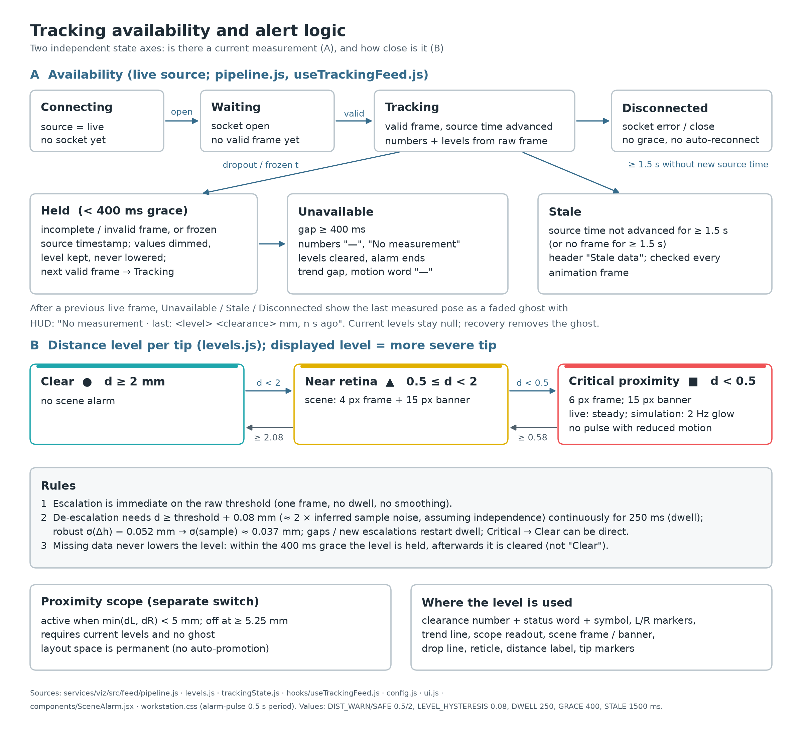

*Fig. 2 – Availability (A) and distance level (B) are independent state axes. Source: `src/feed/pipeline.js`,
`levels.js`, `trackingState.js`, `config.js`.*

### 3.2 Rules

| rule | value | basis |
|---|---|---|
| escalation | immediate, first frame across the raw threshold | reasoning: a warning must never be late because of filtering |
| hysteresis (de-escalation) | 0.08 mm | measurement + assumption: robust σ(Δh) = 0.052 mm; inferred per-sample σ ≈ 0.052/√2 = 0.037 mm under independent, equal-variance sample noise; 0.08 mm ≈ 2 × 0.037 (`alarm_eval/results.md`) |
| de-escalation dwell | 250 ms continuous | measurement + reasoning: suppresses one-frame outliers that hysteresis cannot (non-robust σ(Δh) 0.35 mm) |
| dropout grace | 400 ms (≈ 12 frames at 30 Hz) | measurement: 168/229 gaps (73.4 %) are <400 ms, but contain only 521/3026 missing frames (17.2 %); median 4, p90 34.4 frames (`ui_replay.csv`, consecutive missing frames per run, all visibility states) |
| missed update | no new valid frame for 200 ms → held (dimmed, "Signal gap") | reasoning: silence is a gap, not a fresh value (`MISSED_UPDATE_MS`, live source only) |
| level during a gap | held, never lowered; cleared after the grace | reasoning: missing data is not evidence of safety within the grace |
| after the grace | current level and numbers cleared, ghost pose; status retains last level/clearance and loss age | reasoning: bounded hold, then explicit unavailability; no separate "lost near retina" state; the critical-bin dropout rate is 29.6 % (§3.3) |
| stale | ≥ 1.5 s without an advancing source timestamp | reasoning (unchanged value) |
| per-tip levels | displayed level = more severe tip | reasoning: Q2, worst case shown |
| retained level | " · clearing" appended while hysteresis/dwell holds a level the raw value no longer supports | reasoning: the held state must not look like an instantaneous classification |

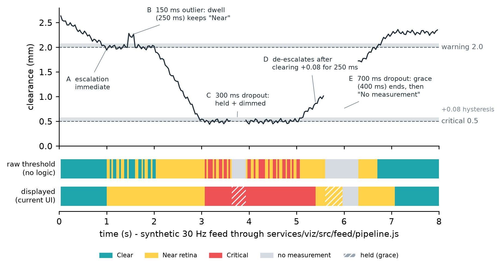

*Fig. 3 – The real pipeline (`src/feed/pipeline.js`) driven by a synthetic 30 Hz feed
(`figures/viz/design/alert_trace.mjs`). Top: input clearance with the 0.08 mm hysteresis bands. Bottom: raw threshold classification vs. displayed level. A–E mark the five behaviours of §3.2.*

### 3.3 Replay against simulator ground truth

Old logic (0.05 mm hysteresis, no dwell, no grace) vs. current logic on all three logged runs (11 428 frames, 381 s; `figures/viz/alarm_eval/results.md`). This
first comparison feeds the reconstructed tip *midpoint* through both logics:

| metric (pooled) | old | current |
|---|---|---|
| all status changes per minute (includes availability) | 106.5 | **37.8** |
| alarms ended by a dropout | 126 | **39** |
| missed critical time (true < 0.5, shown otherwise) | 0.63 s | **0 s** |
| false critical time (shown < 0.5, true ≥ 0.5) | **13.8 s** | 43.4 s |
| time without a measurement shown | 26.5 % | 15.6 % |

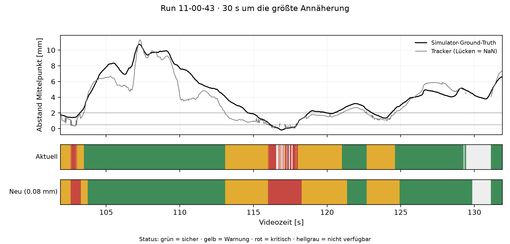

*Fig. 4 – 30 s around the closest approach in run 11-00-43: true and reconstructed height, and the status shown by the
old and new logic.*

**UI-faithful replay.** A second replay reconstructs both tips from the cached detections, feeds them through the actual JS pipeline (status identical frame by
frame for all 11 428 frames) and compares with the logged midpoint as the truth proxy (single-tip truth is not logged):

| metric (pooled, current logic) | value |
|---|---|
| Critical: positive predictive value / sensitivity | **3.2 %** / 100 % (one true episode, 1.8 s) |
| ≥ Near retina: positive predictive value / sensitivity | 22.6 % / 80.9 % |
| all status changes per minute | 37.80 (240 transitions) |
| level changes/min (both frames measured: Clear / Near / Critical) | 18.59 (118) |
| transitions to / from no measurement, per minute | 9.61 / 9.61 (61 / 61) |
| median Critical episode duration | 0.73 s (58 completed; 1 right-censored at 0.23 s) |
| false critical time | 54.9 s (14 % of the session) |
| true height at the onset of a Critical display, median (p05, min) | **3.0 mm** (1.1, 0.73) |
| observed critical episode endings by grace expiry (data loss) | 32 of 58 (59 episodes, one right-censored) |
| frames without a 3D position, true height < 2 mm vs ≥ 2 mm (visible frames only) | 18.1 % vs 24.7 % |
| frames without a 3D position, true height < 0.5 mm (visible frames only) | 16/54 (29.6 %), all in the single true critical episode |

Transition counts use adjacent frames within each run only; rates divide by all 11 428 frames / 30 Hz, not just measured time. Episode duration counts occupied
frames / 30; including the censored observation leaves the median at 0.73 s. Reproduce with `alarm_eval/status_summary.py`.

**Q2 stability (published nearest-tip label).** A **500 ms** continuous candidate dwell follows the unchanged 0.10/0.15 mm tie band and 0.05 mm side lead
(`src/feed/pipeline.js`, `createNearestTipTracker`; `src/config.js`). Gaps interrupt candidate evidence; the label survives grace and resets on loss.
On the same replay, label changes fall **70.7 → 9.9/min**, direct L↔R flips **15.9 → 2.1/min**. Counts exclude initialisation, availability edges and run
boundaries; rates divide by the full 380.93 s. All **37** reconstructed asymmetries lasting ≥1 s with consistent side and |L−R|>0.15 mm are detected,
with maximum published latency **567 ms** (including the readout cadence). Short side changes are deliberately withheld; this is stability against
reconstructed evidence, not proof of correct anatomical side (per-tip truth is absent, §7). Source: newest section of `alarm_eval/results.md`.

**What "Critical" means today, stated plainly.** With the current tracker, "Critical proximity" means "the tracker's estimate is within 0.5 mm". Critical onset
height was 3.0 mm median (range 0.73–8.16 mm), and only about 1 in 30 seconds of Critical display coincided with a true clearance below 0.5 mm. It is a training
cue whose specificity is limited by the tracker (−0.5 mm bias, heavy tails), not a 0.5 mm guarantee; the fix is upstream (perspective model, GitHub issue #1).
The UI does not correct the bias (§6).

**Trade-off of the stabilising rules.** The new logic is much calmer and closes the gaps in the only true critical episode, but holding and slower release
lengthen every episode, and most episodes are false to begin with. Stability was bought with specificity; it does not improve accuracy. The UI-faithful sweep
(`alarm_eval/ui_sweep.csv`) compares critical threshold / hysteresis / dwell (mm / mm / ms), with grace fixed at 400 ms:

| setting | false Critical (s) | missed Critical (s) | changes/min |
|---|---:|---:|---:|
| current: 0.5 / 0.08 / 250 | 54.90 | 0 | 37.80 |
| 0.5 / 0.05 / 0 | 37.77 | 0 | 56.39 |
| LORO-selected: 0.3 / 0.05 / 0 | 33.03 | 0.067 | 57.81 |
| candidate: 0.3 / 0.08 / 250 | 50.27 | 0 | 37.64 |
| 0.5 / 0.15 / 250 | 55.20 | 0 | 37.17 |
| 0.5 / 0.08 / 500 | 64.10 | 0 | 35.12 |

The current setting is neither on the false/missed Pareto front nor the most stable: all 500-ms dwell settings have fewer changes/min (34.49–35.44), and 0.3 /
0.08 / 250 lowers false time and changes with equal missed time. Parameters remain unchanged because only one true critical episode exists; evaluate that
candidate once more true episodes exist. LORO selects on two runs and tests on the third; the fold containing the true critical test episode has no true
critical training episode. It cannot establish generalisation from these three runs. There is no monotonic dropout concentration towards the retina, but the
<0.5 mm bin has 29.6 % missing frames, all in that one episode; 32/58 observed Critical endings follow grace expiry. The 18.1 % vs 24.7 % aggregate comparison
does not establish that data loss near danger is harmless. Caveats: midpoint truth proxy, 12.05 mm logged radius, offline availability mask rather than live
transport telemetry, and reuse of the same three runs. Residual chatter is tracker-limited: no tested sweep setting falls below ≈34 total status changes/min;
more hysteresis/dwell alone cannot establish acceptable stability.

### 3.4 Visual only, and the pulse rate

The workstation has no audible alarm (reasons in §6). Visual alarm signals follow the structure of IEC 60601-1-8 [A1] **as a design framework, not as a
conformity claim**: the standard's alarm-indicator table (as commonly cited; edition not checked) asks for red flashing at 1.4–2.8 Hz for high priority, yellow
flashing at 0.4–0.8 Hz for medium and a constant light for low priority.

- *Critical*: constant **6 px** red frame (previously 3 px), banner "■ Critical proximity · x.x mm".
  **Live tracking is steady:** `CRITICAL_PULSE_LIVE = false` (`src/config.js`) adds `scene-alarm-steady`
  (`src/components/SceneAlarm.jsx`, `src/workstation.css`). With Critical PPV only 3.2 %, a mostly-false
  pulsing red cue risks teaching trainees to ignore red (reasoning, not a measured training effect).
- Simulation/manual sources retain the inner glow modulated at **2 Hz** (0.5 s period,
  `src/workstation.css`). This lies in the cited high-priority frequency band, but is not a flashing
  indicator in the standard's sense: the frame never switches off; peripheral detectability is untested (§7).
  Restore the live pulse only after a replay reaches **Critical PPV ≥30 %**, e.g. after the perspective model
  (GitHub issue #1; evaluation step 3). This is a provisional engineering criterion, not clinical validation.
- *Near retina*: constant **4 px** yellow frame (previously 2 px), the cited low-priority pattern; a deliberate
  under-signalling of a state the tracker cannot resolve reliably (§2.5).
- Banner text is **15 px** (previously 12 px; `src/workstation.css`). Wider frames and larger text target
  readability at an instructor's viewing distance (reasoning; not yet user-tested).
- 2 Hz is below WCAG 2.3.1's three-flashes-per-second frequency limit [C4]; `prefers-reduced-motion` disables the glow.

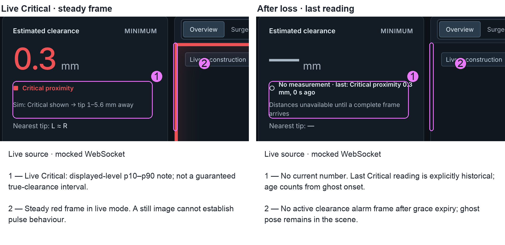

*Fig. 4b – Live-source rendering via mocked WebSocket: steady Critical frame and displayed-level accuracy note (`17_live_critical`), then a separate loss capture (`20_live_ghost_last`). The ghost has no current number or active alarm; "No measurement · last: Critical proximity 0.3 mm, 0 s ago" is history. Still images demonstrate appearance, not pulse or grace timing (Fig. 3).*

## 4 Element-by-element rationale

### 4.1 Clearance card – changed

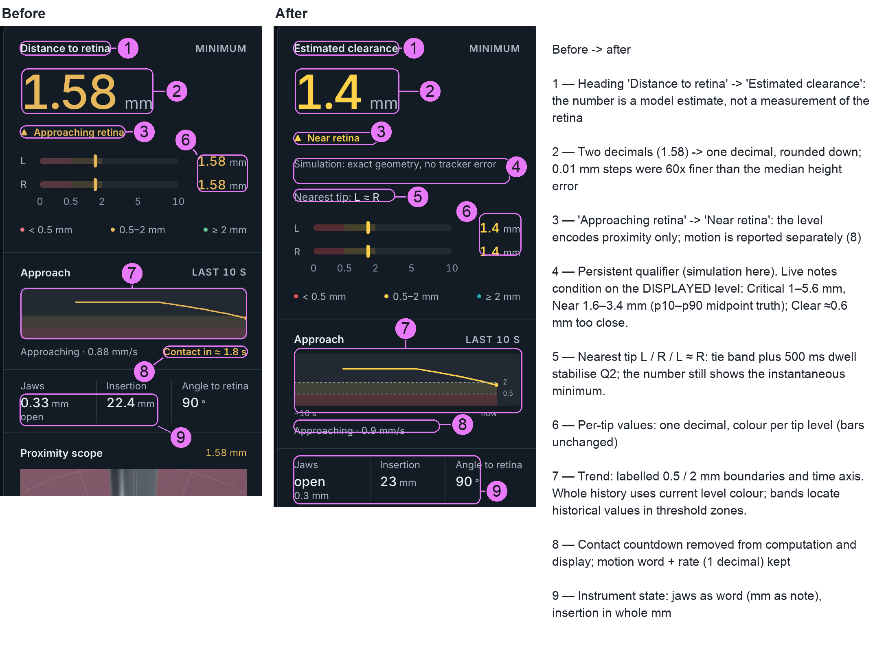

*Fig. 5 – Left column during an approach (`08_approach_trend.png`, before and after; moving captures differ slightly in timing, 1.58 vs 1.5 mm). Numbers in the key describe
each change.*

- **Heading** "Distance to retina" → "Estimated clearance": the value is a model estimate (§2.1).
- **Precision** two → one decimal (§2.3).
- **Status words** "Above warning threshold / Approaching retina / Critical proximity" → "Clear / Near retina /
  Critical proximity". "Approaching" described proximity but read as motion, and could appear together with
  "Retracting" in the trend. Motion now has one place (§4.3). The words stay paired with ● ▲ ■, so
  the level never depends on hue alone [C3, C4 1.4.1].
- **Accuracy note** added (§2.4), now selected by displayed level; 12 px qualifier.
- **Legibility and layout:** "Nearest tip" uses 13 px, with its value in body text colour (the prefix stays muted). Both rows reserve height, including without data, so changes of text do not move the bars or panels (`src/workstation.css`, `.distance-qualifier`, `.distance-nearest`).
- **Nearest tip** "L / R / L ≈ R" added for Q2: the minimum can switch between jaws, and the bars alone required
  comparing two marker positions. With hysteresis against flicker: a tie is entered below 0.10 mm difference and left
  above 0.15 mm, and L↔R switches need 0.05 mm (`src/feed/pipeline.js`); a 500 ms continuous candidate dwell further reduces label switching (§3.3). The reconstructed L−R difference has robust noise estimate 0.0206 mm
  (adjacent differences, MAD/√2); the tie band exceeds that estimate. True per-tip accuracy remains unmeasured (§7).
- **Kept:** one large number (58 px) as the only element with that weight [S5, unverified edition]; "No measurement" instead of a number when there is none; stale is identified in the header.

### 4.2 Per-tip depth bars – kept

Square-root scale over 0–10 mm (`src/ui.js`), ticks 0 / 0.5 / 2 / 5 / 10, threshold zones shaded. Reasoning: the first 2 mm are the decision-relevant
range; on a 170 px track the square root gives them 45 % of the length (0.5 mm at 22 %), a linear scale 20 % (0.5 mm at 5 %, 8 px). Position adds a second,
hue-independent channel per tip [C1, C3]. Values outside 10 mm clamp to the end.

### 4.3 Approach trend – changed

- **Before:** sparkline with shaded zones, no axis, no boundary labels; "Approaching · 0.88 mm/s" plus a coloured
  "Contact in ≈ 1.8 s".
- **After:** dashed zone boundaries at 0.5 and 2 mm with labels outside the plot area, a "−10 s / now" time axis,
  motion word with one-decimal rate ("Holding steady · 0.0 mm/s" included, so the field never jumps).
- **Square-root axis kept.** The trend uses exactly the bar scale, so a level reads the same in both. The cost is that
  the visible slope is not the velocity – which is why the rate is given as a number.
- **Current-level stroke.** The entire 10 s path uses the current level colour (`src/components/ApproachTrend.jsx`):
  a past Clear segment becomes yellow while the current level is Near. This prioritises the present state, but stroke hue
  cannot be read as historical status. Zone bands locate past values in the raw threshold zones; they do not record
  hysteresis/held levels. A neutral stroke was considered and not adopted in this iteration (design choice, not tested): it
  would remove the one place where the current level is repeated next to its own history; a per-segment colouring is the alternative if the evaluation shows misreadings.
- **Time-to-contact removed from computation and display.** `src/feed/trend.js` returns only time, points and velocity; TTC = d / (−v) multiplies the uncertainty of two noisy, biased estimates and was
  displayed as a single figure with its own colour scale, independent of the distance level. Using the near-retina midpoint bias −0.33 mm, a
  tip truly 1.5 mm away approaching at 0.53 mm/s would read (1.5 − 0.33) / 0.53 ≈ 2.2 s instead of 2.8 s
  (illustrative constant-speed calculation, before the min-tip offset and truncation). Lee's
  time-to-collision [S3] is an optical quantity the observer extracts; a computed countdown on top of a biased
  distance is a prediction presented as a measurement (reasoning). Q3 is answered by the trend and the motion word.
- Velocity: least-squares slope over the last 600 ms of contiguous samples, ≥ 4 samples over ≥ 250 ms, then an
  exponential smoothing with weight 0.5 per readout snapshot; |v| ≤ 0.15 mm/s counts as holding (`src/feed/trend.js`).
  Snapshots come every 100 ms plus immediately on level changes, so the effective smoothing time constant is not
  fixed. A gap breaks the line.

### 4.4 Instrument state – changed (format only)

Jaws shown as the word "open / closed" with the opening (1 decimal) as a note; insertion in whole millimetres; angle to the retina in whole degrees. Reasoning:
these are context for the trainee's technique, not safety values, so they use less precision and less visual weight than the clearance. Values dim while held.

### 4.5 3D cues – kept, with three changes

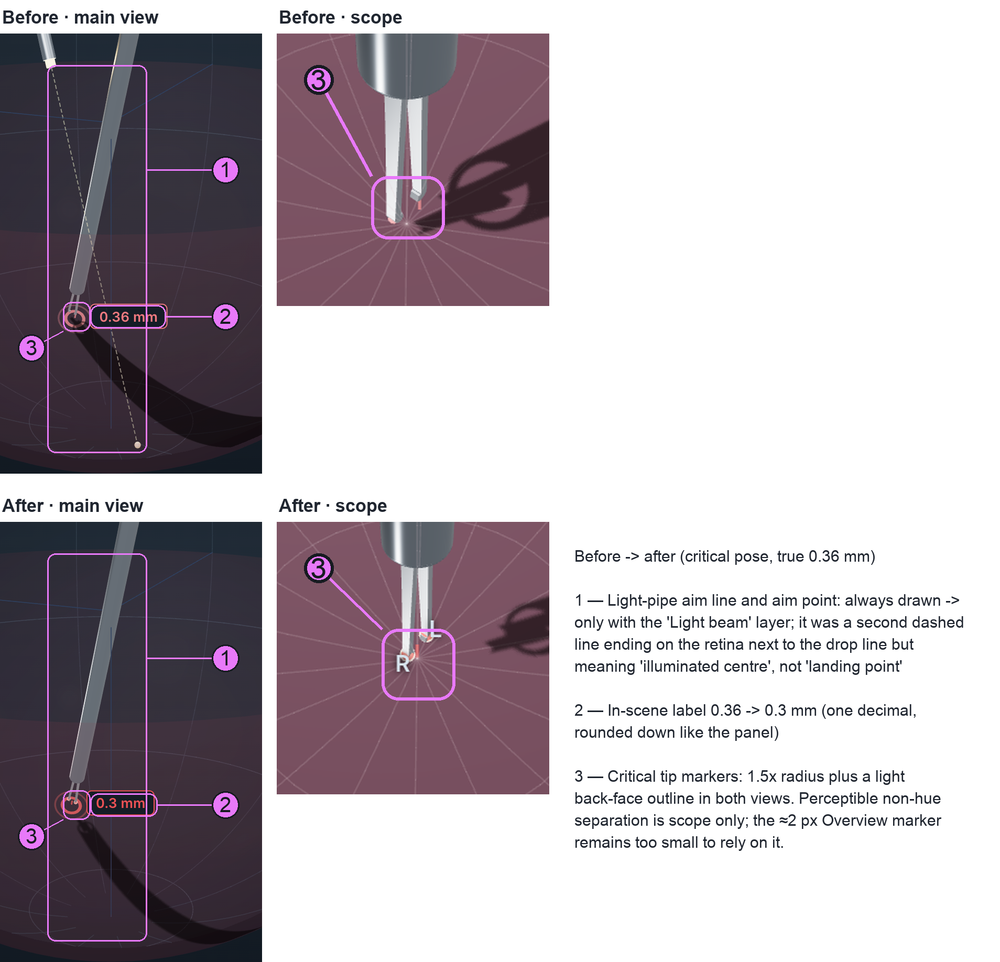

*Fig. 6 – Critical state (pose clearance 0.357 mm, shown "0.36" before and "0.3" after), main view and scope.*

| cue | decision | rationale |
|---|---|---|
| instrument shadow (shadow-only spotlight at the tracked light tip) | kept, default on | cast shadows are a strong cue for depth and motion in depth [D1]; the tracker itself reconstructs depth from the same shadow (reasoning). The light's emitting tip sits exactly at its trocar in the setup, in the tracker's calibration (`light_depth_mm` 0) and in the simulated feeds (`src/feed/mockGenerator.js`, `feed/synthetic_feed.py`), so the light position is fixed and known and the shadow geometry can be inverted directly; without insertion the light pipe aims at the eye centre (`src/scene/LightPipe.jsx`). Caveat: a convincing shadow from a wrong light pose looks just as convincing. |
| drop line + landing reticle | kept, default on | radial projection of the panel's **stabilised nearest tip** (tie → tip midpoint) onto the sphere; line length is that anchor's radial gap, the ring marks its foot point. The number remains `min(L,R)`, rounded down, even while the anchor is retained (`src/geometry.js`, `readoutTip`; `src/scene/LandingReticle.jsx`). It is **not** a predicted landing point along the shaft (§6). |
| in-scene distance label | changed: 1 decimal, rounded down; dims while held | number remains raw `min(L,R)` rounded down; position follows the same stabilised side (tie → midpoint) in the interpolated scene (§5; `src/scene/DistanceLabel.jsx`). |
| globe cutaway | kept | removes the camera-side half of shell, grid and axes, keeps retina and limbus, with ±0.5 mm hysteresis when the camera crosses the shell; context-preserving cut-away in the sense of [D2]. |
| ghost ("last known pose") | kept | faded instrument, neutral tips, no shadow/reticle/label/scope, banner with age; never mixed with a new frame. |
| light-pipe aim line + aim point | changed: only with the "Light beam" layer | it was a second dashed line ending on the retina beside the drop line, meaning "illuminated centre", not "landing point" – two similar marks with different meanings (reasoning). |
| critical tip markers | changed: 1.5× radius + light back-face outline | the red marker disappeared against the red-tinted retina and drop line; size and luminance give a perceptible non-hue cue **in the scope only** (Fig. 6; `after/16`); at ≈2 px in the Overview (`after/04`) the marker is too small to rely on this distinction. Near/Clear markers are still hue-only (§7). |

The reticle foot point inherits lateral reconstruction error (3D median 1.40–2.45 mm, §2.2); it is a model projection, not a verified retinal location. The
shadow also inherits tracked tip/light-pipe placement errors; the measured forceps 3D error does not separately quantify light-pipe accuracy.

### 4.6 Proximity scope – changed framing

A persistent close-up of the retinal wall below the tips: curved cap at the true sphere radius, radial/concentric grid, 42° FOV, anchored to the radial
projection of the **tip midpoint** (so the view does not jump when the nearer tip switches), following with a 0.08 s time constant; drag rotates
(`src/scene/ScopeCamera.jsx`, `src/scene/ProximityWall.jsx`). Active below 5 mm, off at ≥ 5.25 mm (hysteresis); standby text states why it is
inactive. Rationale: the overview cannot show sub-millimetre gaps at its scale; a coordinated second view with a shared object answers the local question while
the overview keeps orientation [D3]. It sits in a permanent panel (§6: no auto-promotion). **Tried and removed: "L"/"R" labels at the jaw tips.** They were added so that "Nearest tip: L" could be found in the
rotatable close-up, but they were removed again: L and R name the jaws relative to the instrument (the tracker's left is the lower
jaw when heading towards the tip), and after orbiting, "L" can sit on the right of the screen, which reads as an error rather than as
help – direction words in a freely rotatable view conflict with the screen-relative reading everybody applies to them (reasoning).
Q2 is answered spatially instead: the drop line and reticle start at the panel's stabilised nearest tip (below), so the nearer jaw is
the one with the line to the retina, in any orientation. L/R wording is kept only where the frame is fixed: the side panel's bars
and "Nearest tip". The caption now says "Tip midpoint over the retina", matching what the camera centres on, and the
readout dims while held. The scope's drop line and reticle follow the panel's stabilised nearest tip (tie → midpoint), while its number remains `min(L,R)` rounded down (`src/components/ProximityScope.jsx`). The camera and wall patch still centre on the midpoint, independently of that cue anchor.

**Framing trade-off (code + screenshots).** Below 1.5 mm, the original camera 8 mm from the foot point is unchanged. Above it, smoothed clearance drives a
smoothstep onset, camera pullback and raised aim: for excess `e=max(0,h−1.5)`, `f=e·smoothstep(e,0,1)`, camera–aim distance `8+1.6f`, aim lift `0.5f` mm. This
keeps tips and foot point in view through the active range up to 5.25 mm for the captured poses, at the cost of local magnification. At 4 mm, camera–aim
distance is 12 mm; camera–foot distance at the default 58° elevation is 13.08 mm, giving ≈61 % of the old local scale (`8/13.08`; ≈51 % at 5.25 mm, 15.62 mm to
foot). These are perspective scale estimates at the foot, not simply `8/12`, and vary with orbit elevation. `baseline/02_near_overview.png` showed neither tip
around 4 mm; `after/02_near_overview.png` shows both and the foot point. This is evidence for that pose, not a visibility guarantee for every orientation.

The tight-framing field at the focus distance is ≈6 mm (`2 × 8 × tan(42°/2) ≈ 6.1`); even 1.4 mm of 3D position error is about a quarter of that field. This is
a scale comparison, not a measured lateral-only error: scope location and retinal detail alignment remain uncertain.

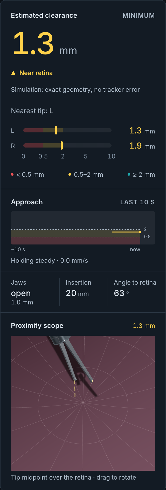

*Fig. 6b – Asymmetric manual pose (`15_asymmetric_near.png`): L 1.3 mm vs R 1.9 mm, both Near retina.
"Nearest tip: L" and the per-tip bars answer Q2; in the scope, the drop line starts at the same (nearer) jaw.
Simulation demonstrates the encoding, not its tracking accuracy.*

### 4.7 View presets and navigation – kept (one accessibility fix)

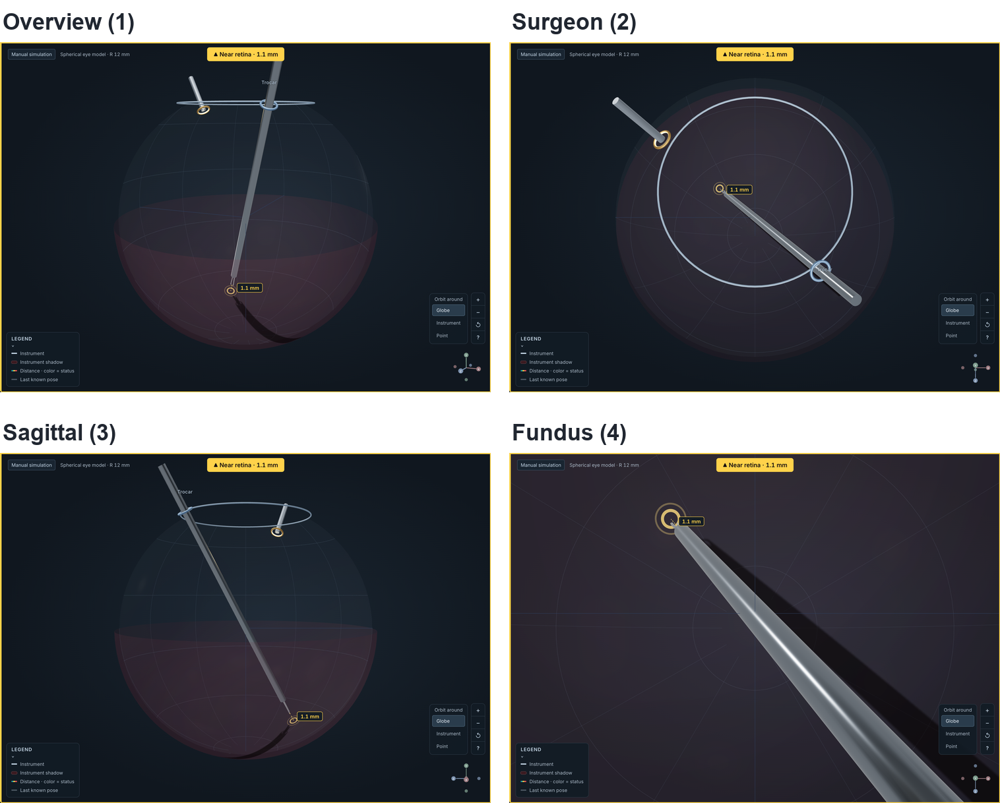

*Fig. 7 – The four presets in the same warning pose.*

The Overview framing is unchanged: it supplies orientation, while the persistent scope carries the local view; no automatic promotion changes the layout at a
threshold (§6).

Overview (orientation), Surgeon (the microscope's top-down direction: lateral position, depth only via label and shadow), Sagittal (a fixed side view; the
clearance appears as a gap to the wall only when the tip lies near the camera's plane – in `after/06_warning_sagittal.png` the tip sits in front of the retina
and the gap cannot be read), Fundus (from inside the globe, towards the posterior pole, roughly the simulator's wide-field view). Each answers a different
spatial sub-question; none is stereoscopic, and exocentric views require a mental transformation [D4]. Keys 1–4, orbit pivot (globe / instrument / picked
point), zoom, reset. **Changed:** the shortcut help dialog now takes focus when opened, keeps it while open, blocks keyboard scene shortcuts behind it, and
returns focus to the "?" button on close (`src/components/NavigationControls.jsx`). The shared mounted-dialog guard (`src/hooks/navigationHelp.js`)
blocks preset keys 1–4 and manual pose keys W/A/S/D, Q/E and arrows (`src/components/ViewPresets.jsx`, `src/hooks/useDebugPose.js`), also clearing
held pose keys while open. F/G/P/R are blocked by local help state; Escape closes the dialog and cancels point picking. This is a keyboard guard, not a claim
that all pointer interaction outside the dialog is disabled.

### 4.8 Status palette and colour-vision deficiency – changed

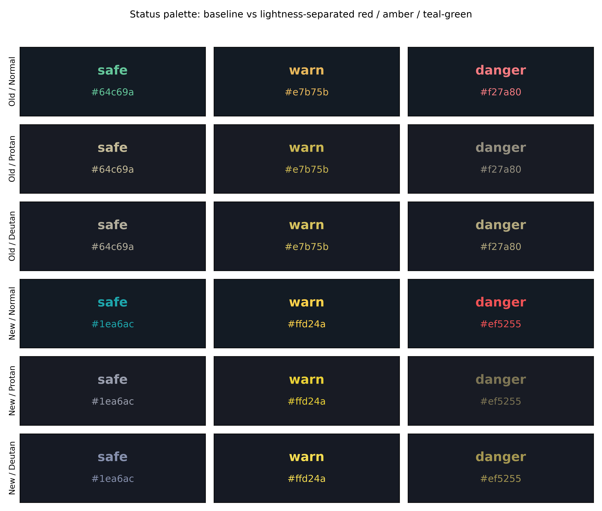

*Fig. 8 – Old and new status colours on the panel surface, normal vision and Machado et al. (2009) protan/deutan
simulation at severity 1.0 (`figures/viz/colour/analyse_status_cvd_v2.py`).*

The old palette (#64c69a / #e7b75b / #f27a80) had nearly equal lightness: luminance contrast between status colours 1.12–1.44:1, and under full deuteranopia
safe vs. danger fell to ΔE00 7.8. The new palette (#1ea6ac / #ffd24a / #ef5255) is re-stepped in lightness and moves "clear" from green to teal, away from the
red–green confusion axis [C3]:

| ΔE00 (CIEDE2000) | safe–warn | safe–danger | warn–danger |
|---|---|---|---|
| normal, old → new | 33.6 → 44.4 | 60.3 → 55.9 | 35.8 → 47.5 |
| protan, old → new | 13.2 → 38.8 | 14.0 → 26.3 | 21.9 → 33.2 |
| deutan, old → new | 18.3 → 46.9 | 7.8 → 35.3 | 13.2 → 21.0 |

Costs: text contrast on the panel drops from 8.34 / 9.36 / 6.51:1 to 5.87 / 12.04 / 4.97:1 (all still ≥ 4.5:1 [C4 1.4.3]); safe–danger luminance contrast stays
low (1.18:1), so that pair still relies on hue plus word and symbol. The model checks tokens, not rendered 3D pixels; tritan was not recomputed for v2.
Connecting/stale/incomplete connection dots are muted; waiting/receiving use the accent (`src/workstation.css`,
`src/components/DeviceHeader.jsx`), reserving saturated clearance hues for levels during ordinary operation. Exception: disconnected/error still uses
danger red (§4.10).

### 4.9 Loss and stale handling – changed

- **Kept:** no number without a current measurement ("—", "No measurement"); old tips are never merged into a new
  frame (`src/feed/trackingState.js`); after a live frame, the ghost pose with "Showing last known pose · n s";
  the HUD status reads "No measurement · last: <level> <clearance> mm, n s ago" (`src/ui.js`,
  `src/components/HUD.jsx`). `lastLevel`/`lastClearance` retain the last published reading and `lostAtMs`
  records ghost onset (`src/feed/pipeline.js`). The age is since loss, not sample age; current levels remain
  null in both stores, so history never raises an alarm. Before any valid frame there is only "No measurement"; a full-area
  "Waiting for tracking data" before the first frame (`after/09_nodata_live.png`).
- **Grace (new).** An incomplete or invalid frame – or, for live data, 200 ms without any new frame – no longer
  clears everything at once: for 400 ms after the last valid frame the last values are held and dimmed to 55 %
  everywhere a clearance appears (hero number, status, nearest tip, bars, scope readout, in-scene label), with "Signal
  gap · holding last value"; the level is frozen (never lowered), the trend gets a gap. Afterwards the normal
  unavailable state follows (Fig. 4b; `after/19_live_held.png` also captures the held rendering). Motivation: in the midpoint replay 126 alarms ended because of a dropout, not because the
  tip moved away (§3.3). A socket error has no grace.
- **Source-time freshness (new).** Before, freshness was the receipt time, so a source re-sending a frozen pose
  stayed "fresh". Now a frame whose source timestamp does not advance is treated as held, and after 1.5 s as stale
  (`src/feed/pipeline.js`). Limitation: `services/stream/ws_server.py` stamps the *send* time, so a stalled
  detector behind a running stream server is still not detected (§7).

### 4.10 Header, legend, labels – connection colours changed

Connection state as dot + word, data-source selector, and for live data calibration and confidence as reported by the source. The current stream omits both
fields (`services/stream/ws_server.py`), so live mode shows "Unknown / —" and cannot trigger uncalibrated/low-confidence qualifiers (§2.4); this remains
open. The scene label "Spherical eye model · R 12 mm" states the model assumption in view; a collapsible legend explains the scene encodings. Connection dot +
word now use muted/accent for connecting/waiting/stale rather than clearance hues (§4.8). Disconnected/error remains red in the current CSS; complete hue
reservation is therefore an open point, not an implemented property.

## 5 Latency and data path

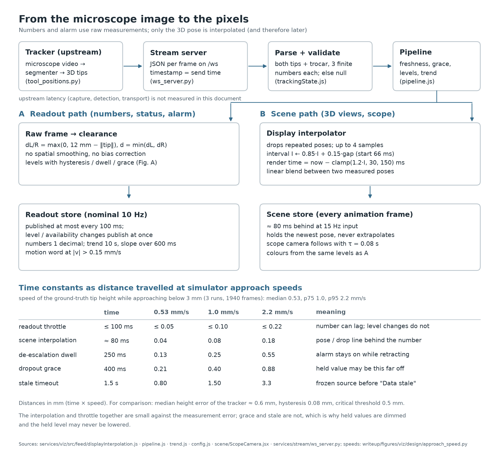

*Fig. 9 – Numbers and alarm use raw measurements; only the 3D pose is interpolated. Bottom: time constants as distance
at the simulator's approach speeds.*

- **Readout path.** Raw frame → clearance → levels; the readout store publishes at most every 100 ms (≤ 10 Hz), but
  any level or availability change publishes immediately, so an escalation is never throttled. No smoothing and no
  bias correction of the number.
- **Scene path.** Live poses are deduplicated and rendered `clamp(1.2 · interval, 30, 150)` ms in the past, ≈ 80 ms
  at the detector's ~15 Hz, blending linearly between two *measured* poses and holding the newest one – never
  extrapolating (`src/feed/displayInterpolation.js`). Purpose: remove stutter in the magnified scope without
  inventing positions [L3: lag is a cost, so it is kept to one sample interval].
- **Consequence.** The drop line can trail the number by ~80 ms; colours always come from the raw-frame levels.

Approach speed of the true tip height below 3 mm in the three logged runs: median 0.53, p75 1.0, p95 2.2 mm/s (`design/approach_speed.py`). As distance
travelled:

| time constant | 0.53 mm/s | 1.0 mm/s | 2.2 mm/s |
|---|---|---|---|
| readout throttle ≤ 100 ms | ≤ 0.05 mm | ≤ 0.10 | ≤ 0.22 |
| scene interpolation ≈ 80 ms | 0.04 | 0.08 | 0.18 |
| de-escalation dwell 250 ms | 0.13 | 0.25 | 0.55 |
| dropout grace 400 ms | 0.21 | 0.40 | 0.88 |
| stale timeout 1.5 s | 0.80 | 1.50 | 3.3 |

Throttle and interpolation are small against the 0.6 mm measurement error; grace and stale are not. That is why held values are dimmed and labelled, why a held
level can only stay or rise, and why the dwell acts only on de-escalation (during retraction it delays the all-clear). Upstream latency (capture,
segmentation, 3D, transport) was not measured; the 167 ms video-to-log offset in learnings §3 is a property of the simulator recording, not of this path.

## 6 Decisions not taken

| not done | reason |
|---|---|
| audible alarm | owner decision for the PoC, although the trainee also reads the screen. Supporting reasons: false-critical time is 54.9 s, 14 % of the session (§3.3); an auditory alarm at that specificity invites alarm fatigue [A2, A3]; sound design for the OP needs its own study (auditory guidance is researched separately, e.g. [O4]). Revisit once the bias is fixed. |
| auto-promoting the scope to the main viewport | a layout change at the moment of highest risk forces re-orientation; the scope already activates in place below 5 mm and the presets are one key away (reasoning). |
| linear trend axis | would give 0–2 mm 20 % of a 64 px chart and break the shared scale with the bars (§4.2–4.3). |
| bias correction in the UI | the −0.5 mm bias is a property of the orthographic 3D model and is reduced in the upstream perspective prototype (learnings §4.5); a UI offset would hide the error source, depend on one calibration and silently turn conservative errors into optimistic ones. |
| more numbers / gauges | each added number competes with the one that answers Q1 [C2]; instrument values are already demoted to context (§4.4). |
| dynamic retina tint by status | would recolour the largest surface on every level change, duplicate the frame alarm and reduce the contrast of tips, shadow and reticle on the retina (reasoning). The retina stays a constant anatomical #8b3a4a at 13 % opacity. |
| trajectory extrapolation (along the shaft, or a predicted landing point / countdown) | extrapolates biased, noisy positions and presents a prediction as a measurement; projection is left to the user via the trend [S1] (§4.3, §4.5). |

## 7 Limitations, open points and evaluation plan

**Limitations.**

- Simulator only: one exercise, one user, three runs, one zoom; idealised eye and shadow (learnings §5).
- All parameters (0.08 mm, 250 ms, 400 ms, 500 ms nearest-tip dwell) were derived and evaluated on the same data; only one true critical episode exists.
- The log contains only the tip midpoint: per-tip accuracy is unmeasured, so Q2 accuracy ("which tip?") is unvalidated despite measured label stability, and every replay uses the midpoint as truth proxy (logged radius 12.05 mm vs the UI's 12 mm).
- Median 3D position error is 1.40–2.45 mm (§2.2); reticle, shadow and scope location can look precise while spatially misplaced. A lateral-only error and light-pipe accuracy are not separately established.
- "After" 01–16 use manual simulation (09 is live without data); 17–20 capture live Critical, Near, held and ghost states through a mocked WebSocket. These demonstrate rendering, not real tracker/transport behaviour; grace timing itself remains covered by unit tests (`tests/pipeline.test.js`) and Fig. 3.
- No user has been tested with the UI.

**Open points.**

1. Freshness needs a capture timestamp from the tracker; the stream's send time cannot reveal a stalled detector. The stream also needs meaningful
   calibration/confidence telemetry; absent fields currently show "Unknown / —" and leave both quality-warning qualifiers unreachable (§2.4).

2. The live accuracy notes are static constants selected by displayed level (§2.4); they should eventually come from the session's calibration.

3. Whether the critical glow is noticed in peripheral vision is untested (evaluation step 2).

4. Near and Clear tip markers in 3D are hue-only; tritan and rendered 3D contrast not measured.

5. Disconnected/error still shares danger red (§4.10).

6. IEC 60601-1-8 values are quoted from secondary knowledge; check against the standard's text before citing.

**Evaluation plan.**

1. *Heuristic evaluation* (2–3 evaluators, Nielsen-style heuristics plus the IEC alarm structure and WCAG 2.2 as checklists) on the 20 scripted screen states in
   `figures/viz/after/`.

2. *Small think-aloud study* (5–6 trainees, one instructor): one simulator task with the workstation visible, then a replay-based debrief. Measures: correct
   answers to Q1–Q3 from a 2 s glance at frozen screens, misreadings of the status words, whether the accuracy note changes trust, and whether the critical
   pulse is noticed or found distracting.

3. *Replay metrics* on every new recording with `alarm_eval/evaluate_ui.py`: total status changes/min split into level changes and transitions to/from no
   measurement, median Critical episode duration, dropout-ended alarms, missed and false critical time, onset latency once more true critical episodes exist; repeat `alarm_eval/display_analysis.mjs` for displayed-level accuracy and Q2 stability.
   Re-run after the perspective model lands; the false-critical time is expected to drop with the bias. Re-enable the live critical pulse only at **Critical PPV
   ≥30 %**; evaluate 0.3 / 0.08 / 250 with more true episodes, reporting sensitivity and missed time alongside PPV. Provisional stability targets: **≤10 level
   changes/min** and **median completed Critical episode ≥1 s** on comparable tasks, alongside PPV ≥30 %, with sensitivity/missed time reported to prevent
   success through suppressed alarms. Current 18.59/min and 0.73 s fail these targets. For Q2, also require **≤10 nearest-label changes/min**, **≤3 direct L↔R flips/min**, and detection of **all sustained asymmetries** (≥1 s consistent reconstructed side, |L−R|>0.15 mm) within **600 ms** of onset. Current 9.92/min, 2.05/min and 37/37 within 567 ms pass on these reused runs; report these alongside level statistics on new recordings. These are engineering acceptance criteria, not clinical validation.

**Reproduce.** `sh writeup/figures/viz/design/build.sh` rebuilds Figs. 1–3, 4b, 5–7 (including 6b), 9 and prints the numbers of §2.2 and §5; Fig. 4: legacy
`alarm_eval/evaluate.py` (which overwrites `results.md`: preserve its UI-faithful supplement); current UI metrics: `alarm_eval/evaluate_ui.py`;
transition/episode split and scope scale: `alarm_eval/status_summary.py`; Fig. 8: `colour/analyse_status_cvd_v2.py`.

## 8 References

Verified DOIs as in `writeup/viz_references_draft.md`; entries marked *(unverified)* were not checked online.

- [A1] IEC 60601-1-8:2006+A1:2012+A2:2020, alarm systems in medical electrical equipment *(unverified edition; used as framework only)*.
- [A2] Cvach, M. (2012). Monitor alarm fatigue: an integrative review. *Biomed. Instrum. Technol.* 46(4), 268–277. doi:10.2345/0899-8205-46.4.268
- [A3] Edworthy, J., Hellier, E. (2006). Alarms and human behaviour. *Br. J. Anaesth.* 97(1), 12–17. doi:10.1093/bja/ael114
- [C1] Ware, C. (2021). *Information Visualization: Perception for Design*, 4th ed. Morgan Kaufmann.
- [C2] Healey, C. G., Enns, J. T. (2012). Attention and visual memory in visualization and computer graphics. *IEEE TVCG* 18(7), 1170–1188. doi:10.1109/TVCG.2011.127
- [C3] Wong, B. (2011). Points of view: Color blindness. *Nat. Methods* 8, 441. doi:10.1038/nmeth.1618
- [C4] W3C (2023). *WCAG 2.2* – 1.4.1, 1.4.3, 1.4.11, 2.3.1. https://www.w3.org/TR/WCAG22/
- Machado, G. M., Oliveira, M. M., Fernandes, L. A. F. (2009). A physiologically-based model for simulation of color vision deficiency. *IEEE TVCG* 15(6), 1291–1298. doi:10.1109/TVCG.2009.113
- [U1] JCGM 100:2008 (GUM), §7.2.6.
- [U2] Kay, M., Kola, T., Hullman, J., Munson, S. (2016). When (ish) is my bus? *CHI 2016*, 5092–5103. doi:10.1145/2858036.2858558
- [U3] Hullman, J. (2020). Why authors don't visualize uncertainty. *IEEE TVCG* 26(1), 130–139. doi:10.1109/TVCG.2019.2934287
- [D1] Kersten, D., Mamassian, P., Knill, D. C. (1997). Moving cast shadows induce apparent motion in depth. *Perception* 26(2), 171–192. doi:10.1068/p260171
- [D2] Bichlmeier, C., Wimmer, F., Heining, S. M., Navab, N. (2007). Contextual anatomic mimesis. *ISMAR 2007*, 129–138. doi:10.1109/ISMAR.2007.4538837
- [D3] Roberts, J. C. (2007). State of the art: coordinated & multiple views in exploratory visualization. *CMV 2007*, 61–71. doi:10.1109/CMV.2007.20
- [D4] Ware, C. (2021). Space perception. In [C1], 245–296. doi:10.1016/B978-0-12-812875-6.00007-4
- [S1] Endsley, M. R. (1995). Toward a theory of situation awareness in dynamic systems. *Hum. Factors* 37(1), 32–64. doi:10.1518/001872095779049543
- [S3] Lee, D. N. (1976). A theory of visual control of braking based on information about time-to-collision. *Perception* 5(4), 437–459. doi:10.1068/p050437
- [S5] Few, S. (2013). *Information Dashboard Design*, 2nd ed. *(unverified edition)*
- [L3] MacKenzie, I. S., Ware, C. (1993). Lag as a determinant of human performance in interactive systems. *CHI '93*, 488–493. doi:10.1145/169059.169431
- [O4] Matinfar, S. et al. (2024). Ocular stethoscope: auditory support for retinal membrane peeling. *MICCAI 2024*, 433–443. doi:10.1007/978-3-031-72089-5_41
